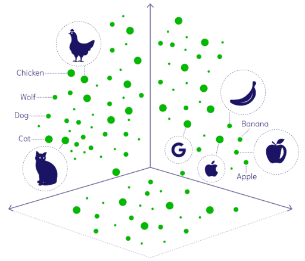
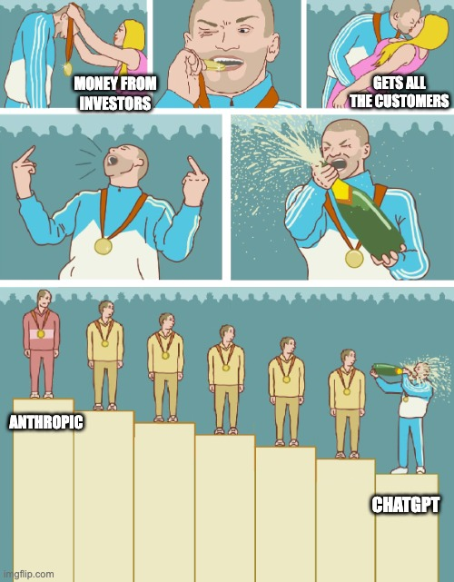
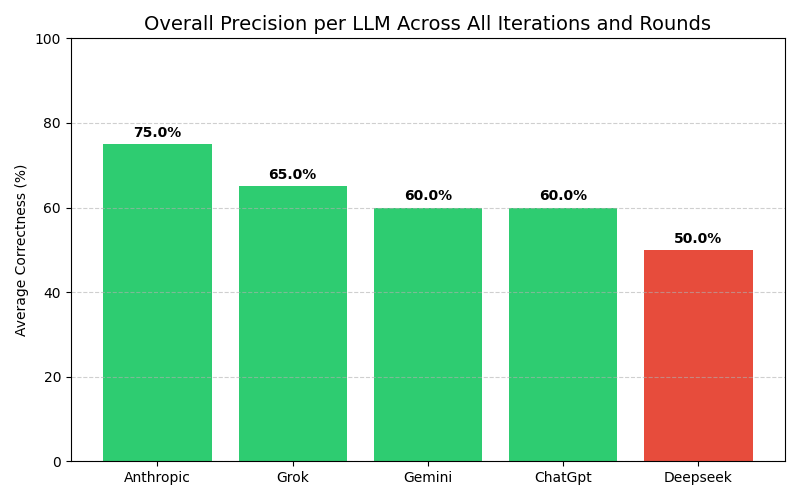
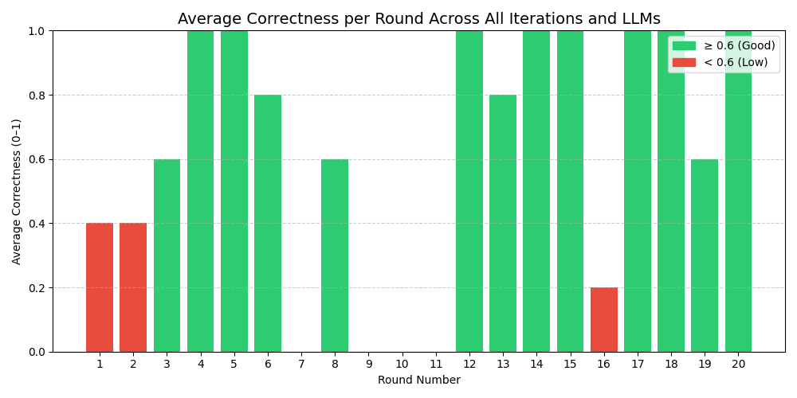
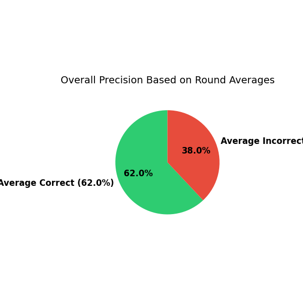
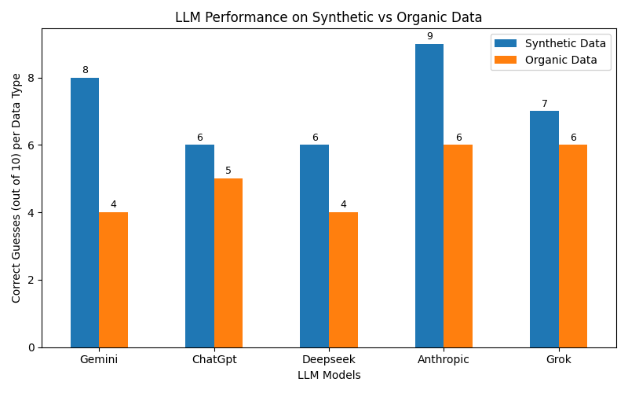
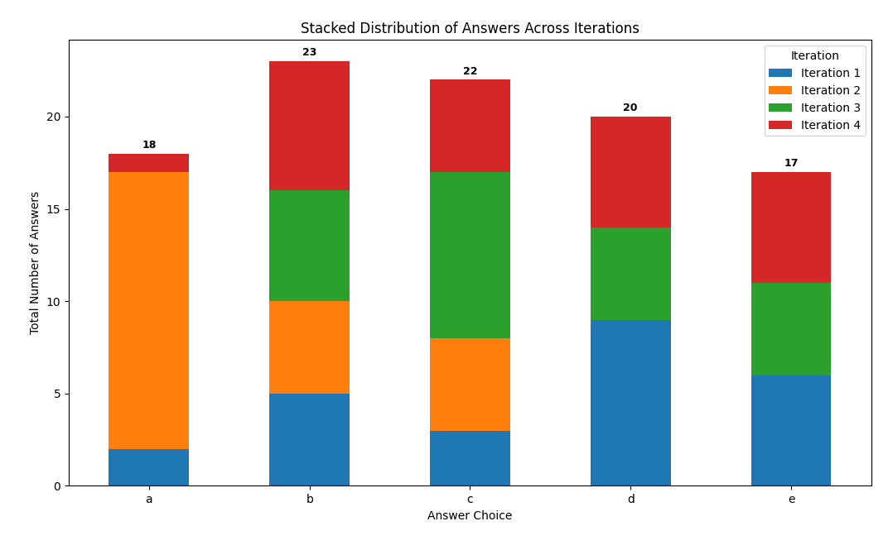
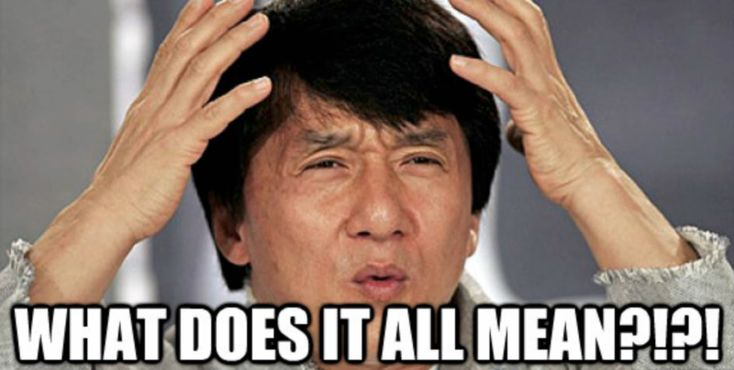

hello reader,

this is my first post. why not start with a simple experiment? 

## question

__Can an LLM identify and profile reliably?__

Let's play a game. 👾

you have to identify a target and there are five suspects.

the evidence you have is a text that belongs to the target and samples of text associated with the suspects.

to identify the target, you'll rely on the good old **llm**. 

but can you rely? and on which one?

## experiment

will have five contestans:

1. Gemini
2. Chatgpt
3. Deepseek
4. Anthropic
5. Grok

across four iterations we will decide on which one it is better to rely, if there is one at all, the champion of identifying an profiling.
each iteration will be slightly different from the other by subject matter, amount of text or the source.


Each iteration has five rounds.
Every round the participants will choose from five a different statement is presented and the participant need to choose the target from one of the five suspects.


the participants will be the detectives.
one on them will also be the target, unkowingly.

There is no memory involved. All 5 LLMs must do the guessing, as it's interesting (for me) to check whether it can identify itself.

## theory

should we even consider an llm for this task?

An llm can definetely internalize `text meaning` and produce predictions in the form of human readable text. 

`Text meaning` is captured using the `embedding space` learned during pretraining.
The embedding space is filled with... __dense vectors of meaning__.



## utility


to identify or profile people or text in general is not a new thing.
there are even open-source tools like for:
...
...
...

People and machines produce a lot of text in social media posts, messages, blogs, news outlets etc. 

LLMs are accessible, and although not cheap, it's interesting to know how reliable they can be at this task. 
will they substitute the tools in use right now?

### Some Real-World Uses of Writing Style Analysis

🔐 Security / Forensics
* Authorship attribution: Identifying anonymous or pseudonymous writers (e.g., in cybercrime, ransom notes, extremist manifestos).
* Plagiarism detection: Checking if text was copied or written by the claimed author.

📈 Business & Marketing (even Politics 😉)
* Brand voice consistency: Ensuring all written material matches a company’s tone.
* Customer profiling: Inferring demographics (age, region, expertise) from writing style.

💻 Technology & AI
* Chatbot/persona detection: Differentiating between human and AI text (or which AI??).
* Personalization: Tailoring responses based on a user’s linguistic profile.
* Fraud prevention: Detecting if an account suddenly “changes style,” suggesting takeover.

🕵️ Intelligence & Law Enforcement
* Tracking online activity: Linking anonymous posts to a known author.
* Psychological profiling: Inferring traits (like personality, mood, deception likelihood) from style.

## How?

### Text meaning - embedding space


### Text structure - stylometric analysis

The `structure` can be can be examined through `stylometric analysis`.

Stylometry is the quantitative study of writing style.
It’s the process of identifying or profiling someone based on their writing.

It’s about measuring patterns in how someone writes — things like:
* word frequency
* average sentence length
* use of punctuation
* vocabulary richness
* rhythm and structure

I'm hoping this on the fly analysis will help by creating an intermediate `thought` that will help provide a better approximation.


First of all there’s no programming involved in this experiment. Don't be scared. It is easy to reproduce by anyone with an internet connection.

_style never lies_ 🎭

### Guess the joker

The game is called _Guess the Joker_.

There are 5 players and each one impersonates a character.
There are five rounds and in each round one the players becomes the joker.

Each player writes a paragraph on a selected topic.
The Joker gives a statement on a different topic to the paragraph: the Joker Statement.

The players should spot the Joker by matching the paragraph to the Joker Statement.

During the generation phase the participant should not reveal its persona whilist remaining “authentic”.

### Input - Output

The technique I will use is Zero-shot prompting.

Zero-shot prompting is a method of interacting with AI models where you provide a direct instruction for a task without giving any examples or prior context.

I've seen LLMs get biased by examples or with a large enough prompt completely confused.

#### Content generation prompt
```
You are a {PERSONA}.  
Write a paragraph of {NUMBER_OF_SENTENCES} sentences about {PARAGRAPH_SUBJECT}.

Write one additional sentence about {JOKER_STATEMENT_SUBJECT}.

Do not disclose your persona, identity, or affiliations.
Maintain an authentic tone, vocabulary, and consistent worldview.
```

#### Guessing Game Prompt

```
You are playing a guessing game.  
Below is a list of options labeled a–e. Each contains a paragraph written by a different persona.

Your task:  
Match the Joker Statement to the paragraph (a–e) that most likely belongs to the same persona.

Options:
{OPTIONS a to e}

Joker statement:
{JOKER_STATEMENT}

You must rely only on:
- Writing style and tone
- Thematic and contextual content
- Linguistic and stylometric clues

Do not use external factual knowledge or reasoning beyond the text itself.

Your answer must include:

1. **Letter:** The option (a–e) you believe matches the Joker Statement.  
2. **Content Analysis:** A short explanation (2–3 sentences) of how the subject matter and themes of the Joker Statement align with the chosen paragraph.  
3. **Stylometric Analysis:** A short explanation (2–3 sentences) describing stylistic similarities — e.g., vocabulary, tone, sentence structure, punctuation patterns, or voice consistency.

Output format:
Letter: {LETTER}

Content Analysis:
{CONTENT_ANALYSIS_TEXT}

Stylometric Analysis:
{STYLOMETRIC_ANALYSIS_TEXT}
```

## Experiments

I'm not claiming a definitive resul here but let's get a feel of the skill levels.


### Iteration 1

#### Overview

* Subject matter: The American Wild West (1865–1895)
* Goal: identify the author
* Context size: Five sentence paragraphs and one joker statment
* Type of content: generated

Our setting is Post–Civil War frontier, expansion westward, law vs. chaos.

The paragraph is a description of the personas life in the period of time while the joker statement is about the The Completion of the First Transcontinental Railroad (1869).

I chose this scenario because:
- the LLMs are obviously trained in US history, so I'm expecting the generated data to be good
- there are different viewpoints to chose from for identifiable personas
- it's as much about identifying the author as it is about profiling based on political view

#### Personas

* U.S. Marshal – enforcing order.
* Outlaw – rebelling against it.
* Settler – ordinary human seeking stability.
* Native Americans – resisting encroachment.
* Mormon – seeking utopian settlement.

#### Generated data

1. Gemini (2.5 flash) - U.S. Marshal
2. Chatgpt - Outlaw
3. Deepseek - Settler
4. Anthropic (sonnet 4.5) - Native American
5. Grok (quick answer) - Mormon

The generated data is available @

[Iteration 1 Generated data]()

#### Result

The detailed results are available @

[Iteration 1 Detailed results]()

**Points**

| LLM | Round 1 | Round 2 | Round 3 | Round 4 | Round 5 | Total Points |
|-----|---------|---------|---------|---------|---------|-------|
| Gemini | 1 | 0 | 1 | 1 | 1 | 4 |
| ChatGpt | 0 | 0 | 0 | 1 | 1 | 2 |
| Deepseek | 0 | 1 | 0 | 1 | 1 | 3 |
| Anthropic | 1 | 1 | 1 | 1 | 1 | 5 |
| Grok | 0 | 0 | 1 | 1 | 1 | 3 |

**Answers**

| LLM | Round 1 | Round 2 | Round 3 | Round 4 | Round 5 |
|-----|---------|---------|---------|---------|---------|
| Gemini | a | d | c | d | e |
| ChatGpt | e | d | d | d | e |
| Deepseek | b | b | b | d | e |
| Anthropic | a | b | c | d | e |
| Grok | b | d | c | d | e |

The obvious takeaway `Anthropic` killed it and ChatGpt underwhelmed.

To me this shows the difference in training material. 
One managed to grasp the subtle differences of the era, while the other seems to do random guessing, having a very similar explanation in every round and attributing all five guesses to Native Americans and Mormons.

All the participants identified the Native American and Mormon personas due to to their distinctive style.

At the same time Gemini, GhatGpt and Grok misidentified the Outlaw persona with the Native American, which some would say smells like bias, but might be related to the use of the word `iron` in the Native American paragraph and the Joker Statement.

### Iteration 2

#### Overview

* Subject matter: Comedian tweets
* Context size: nine tweets for context, one tweet as the joker statment
* Type of content: real

I collected ten relatively recent tweets from American comedians that AI suggested.

My hope is that the large language models weren't trained on this data.

One tweet is used as the joker statement while the other nine are used as context for the options.

Comedians have different styles of writing and structuring the jokes, they have different sensibilities and convinctions.

#### Personas

* [Simon Holland](https://x.com/simoncholland)
* [Curly Comedy](https://x.com/curlycomedy)
* [Electro Lemon](https://x.com/electrolemon)
* [Adam Carolla](https://x.com/adamcarolla)
* [Mark Norm](https://x.com/marknorm)

#### Real data

1. Simon Holland
2. Curly Comedy
3. Electro Lemon
4. Adam Carolla
5. Mark Norm

The generated data is available @

[Iteration 2 Real data]()

#### Result

The detailed results are available @

[Iteration 2 Detailed results]()

**Points**

| LLM | Round 1 | Round 2 | Round 3 | Round 4 | Round 5 | Total Points |
|-----|---------|---------|---------|---------|---------|-------|
| Gemini | 1 | 0 | 0 | 0 | 0 | 1 |
| ChatGpt | 1 | 0 | 1 | 0 | 0 | 2 |
| Deepseek | 0 | 0 | 1 | 0 | 0 | 1 |
| Anthropic | 1 | 0 | 1 | 0 | 0 | 2 |
| Grok | 1 | 0 | 0 | 0 | 0 | 1 |

**Answers**

| LLM | Round 1 | Round 2 | Round 3 | Round 4 | Round 5 |
|-----|---------|---------|---------|---------|---------|
| Gemini | a | a | b | b | a |
| ChatGpt | a | a | c | c | a |
| Deepseek | b | a | c | c | a |
| Anthropic | a | a | c | a | a |
| Grok | a | a | b | b | a |

Miserable results across the board.
At the same time, I would argue that a joke 
grasping the human humor is still difficult
maybe the jokes are not an llms best suite even for grok.

### Iteration 3

#### Overview

* Subject matter: GeForce RTX 50 Series and GeForce RTX 30 Series graphics cards
* Context size: Twenty sentences for context options and twenty sentences as the joker statement. 
* Type of content: generated

The LLMs are asked to describe the GeForce RTX 50 Series in twenty sentences.
The description should include use cases, performance in comparison to other similar models, specs if available and an opinion about it.

The same should be done for the GeForce RTX 30 Series graphics card that will be used as the joker statement.

There are no personas, the question is whether an LLM can identify another LLM based on the style of writing, a technical review in this case.

#### Personas

Technical reviewer.

* Gemini
* Chatgpt
* Deepseek
* Anthropic
* Groke

#### Generated data

1. Gemini (2.5 flash)
2. Chatgpt
3. Deepseek
4. Anthropic (sonnet 4.5)
5. Grok (quick answer)

The generated data is available @

[Iteration 3 Generated data]()

#### Result

The detailed results are available @

[Iteration 3 Detailed results]()

**Points**

| LLM | Round 1 | Round 2 | Round 3 | Round 4 | Round 5 | Total Points |
|-----|---------|---------|---------|---------|---------|--------------|
| Gemini | 0 | 1 | 1 | 1 | 1 | 4 |
| ChatGpt | 0 | 1 | 1 | 1 | 1 | 4 |
| Deepseek | 0 | 1 | 0 | 1 | 1 | 3 |
| Anthropic | 0 | 1 | 1 | 1 | 1 | 4 |
| Grok | 0 | 1 | 1 | 1 | 1 | 4 |

**Answers**

| LLM | Round 1 | Round 2 | Round 3 | Round 4 | Round 5 |
|-----|---------|---------|---------|---------|---------|
| Gemini | c | b | c | d | e |
| ChatGpt | c | b | c | d | e |
| Deepseek | c | b | b | d | e |
| Anthropic | c | b | c | d | e |
| Grok | c | b | c | d | e |

### Iteration 4

#### Overview

* Subject matter: Business (kindof)
* Context size: About ten sentences for context options and five sentences as the joker statement. 
* Type of content: real (hopefully 🤞)

I took Substack's rising `Bestsellers in Business` writers, and extracted some content for this iteration.
(as of 25th of October 2025)

It was harder to string a full ten sentences without some picture or ad, but I think I made an ok job gaterhing this. 

#### Personas

1. [Derek Thompson](https://substack.com/@derekthompson/)
2. [Tom Orbach](https://substack.com/@marketingideas/)
3. [Penelope Trunk](https://substack.com/@penelopetrunk)
4. [Ethan Mollick](https://substack.com/@oneusefulthing)
5. [Amy Suto](https://substack.com/@sutoscience)

#### Real data

The real data is available @

[Iteration 4 Real data]()

#### Results

The detailed results are available @

[Iteration 4 Detailed results]()

**Points**

| LLM | Round 1 | Round 2 | Round 3 | Round 4 | Round 5 | Total Points |
|-----|---------|---------|---------|---------|---------|--------------|
| Gemini | 0 | 1 | 1 | 0 | 1 | 3 |
| ChatGpt | 0 | 1 | 1 | 1 | 1 | 4 |
| Deepseek | 0 | 1 | 1 | 0 | 1 | 3 |
| Anthropic | 0 | 1 | 1 | 1 | 1 | 4 |
| Grok | 1 | 1 | 1 | 1 | 1 | 5 |

**Answers**

| LLM | Round 1 | Round 2 | Round 3 | Round 4 | Round 5 |
|-----|---------|---------|---------|---------|---------|
| Gemini | e | b | c | b | e |
| ChatGpt | d | b | c | d | e |
| Deepseek | d | b | c | b | e |
| Anthropic | d | b | c | d | e |
| Grok | a | b | c | d | e |

Almost perfect results in this round with Grok winning and Gemini with Deepseek trailing behind everyone else.

## Conclusion



Joke aside, I'm using mostly ChatGpt because of the speed of response and my way of using LLMs in general, which is mostly advanced search, or to produce code snippets.

| LLM | Iteration 1 | Iteration 2 | Iteration 3 | Iteration 4 | Total |
|-----|---------|---------|---------|---------|-----|
| Gemini | 4 | 1 | 4 | 3 | 12 |
| ChatGpt | 2 | 2 | 4 | 3 | 11 |
| Deepseek | 3 | 1 | 3 | 3 | 10 |
| Anthropic | 5 | 2 | 4 | 4 | 15 |
| Grok | 3 | 1 | 4 | 5 | 13 |

For a professional look let's plot 📈 the hell out of this data .

### Precision



What would happen if we would've taken into account the responses from all models and averaged.



For a total of:



So I guess it's better to choose the champion model and go with that.

### Synthetic Data vs Organic Data

Bear in mind the 2nd iteration was a disaster, 



It seems that the the LLMs are making better guesses on generated data, than real data. But this is debatable, as the 2nd iteration was a complete disaster, as the models clearly couldn't grasp the stylistical differences of the jokes.

### Distribution of answers across iterations

Not yet sure how to interpret this, but the models seem to be highly swayable depending on the content.

For example in iteration 2 they prefferred `a` by a mile.
`b` and `c` the middle is preferred, first of all the only ones to have answers in all four iterations. There's a clear bias towards the options in the middle.



Training data vs context?

I wouldn't say the stylometry made a difference in the choices of the
LLMs, the `latent space` made all the difference.



One needs to choose the model by experimenting and understanding what type of context is it better suited for.

Inconclusive.


Stay safe, 
Ciao!