I’m finding it hard to finish the first post... why not start with the second one?

I’m warning you, this is a sidequest. ⚔️

# Question

Are large language models biased towards certain options?

If we have `a`, `b`, `c`, `d` or `e`. Is it more likely that the model will choose `a` over `e` when there's no meaningful reason to do so.

To assess this let’s ask ourselves,

**Which color does Sam like?**

a. red

b. blue

c. green

d. yellow

e. other

a million times.

Why?

# Backstory

It all starts while playing a game. The large language model has to identify the target from a set of five suspects. a to e.

I observe that there is a slight preference for the options `b`(23), `c`(22) and `d`(20) from a hundred total answers.
When the model nails every question,  all options would have twenty answers.But the precision is lower than expected, at 62%.

I am sensing some **bias** vibes towards certain options, but there are not enough iterations of the experiment to make a case.

The data might also be part of the problem, ideally it affects the answers. b might’ve been more suspicious all along.

# Methodology

Model: gpt-4.1
Temperature: 0.5

I want to test this with a random question. The provided options should have the same probability to be correct. Sam is a random person, and colours are random options. There should be a balanced distribution of hits for each option. Or, so I thought.

(Obviously it’s those green 💵 bills.)

What if there’s bias towards a specific color? How strong and persistent is this bias? Spoiler alert: there is. 

I permutate the values of each option and run ten iterations for each permutation. This way I track a potential bias towards a certain value. 🕵️ 

And also by running each permutation ten times I’m looking for the consistency of the response.

I am looking for two numbers:
1. the number of hits per option value (red, blue, green, yellow, other) 
2. the number of hits per option name (a, b, c, d, e).

The first one reveals if there is a bias towards a certain color.

The second reveals if there is a bias towards a certain option.

# Short Answer


The answer is blue. Surprisingly, but not really.

Blue is a very popular color.
I searched around and found that:
[A worldwide survey reveals that blue is the most popular colour in 10 countries across four continents – including China](https://today.yougov.com/international/articles/12335-why-blue-worlds-favorite-color)

The most popular color, by a mile. And the numbers? The numbers don't lie.

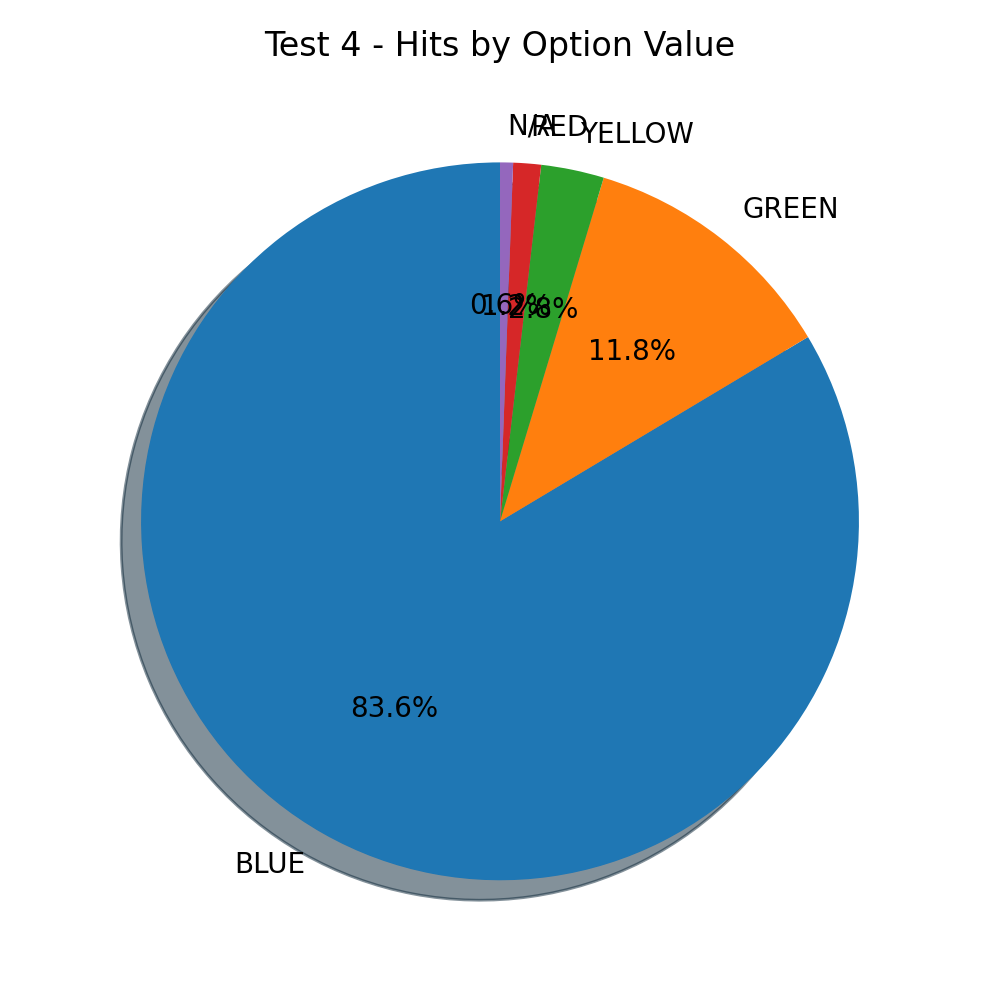

83.6 percent is a lot of blue.

It is blue for men and women of different names, and also blue if you ask its own favorite color. The responses are annoyingly persistent. Fair distribution expectation gone.

But, what about the option position bias?

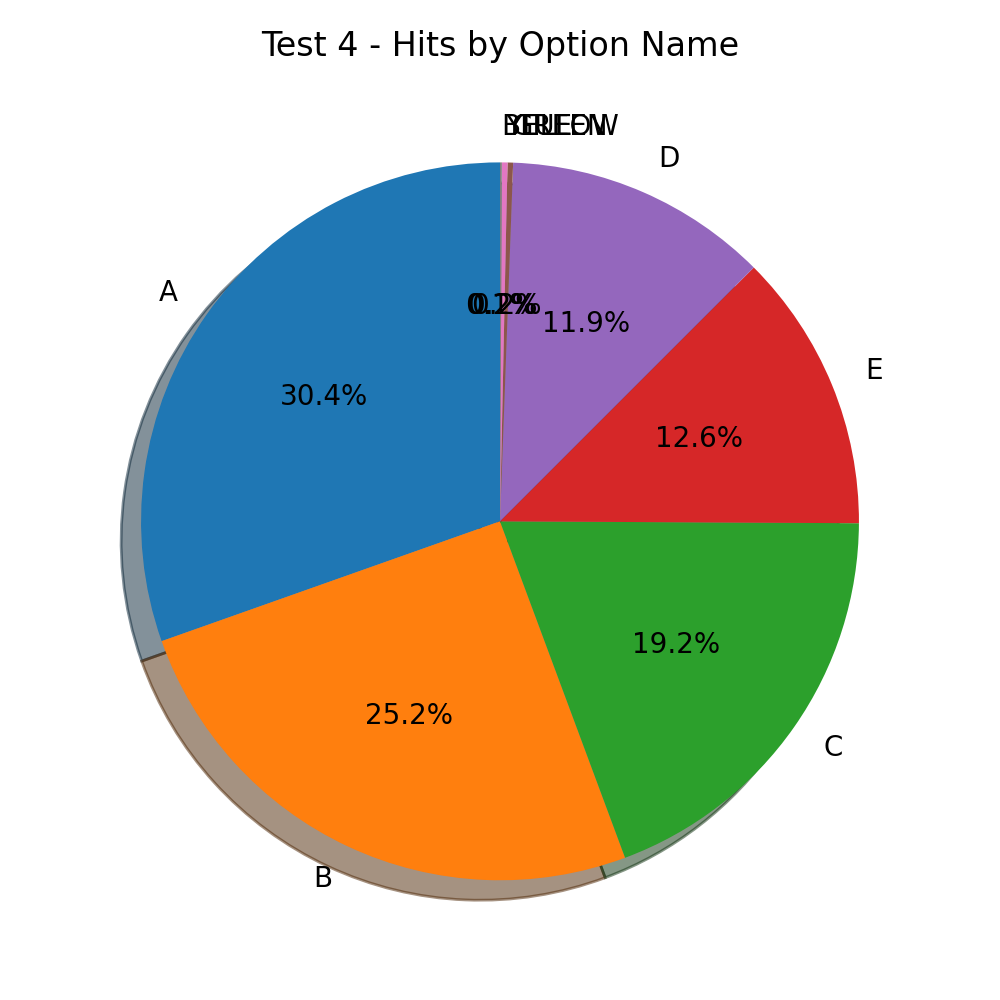

I am running the tests by permutating the colors across the options.
This means I am expecting a fair distribution of 20% percent of hits for each option. 
What I found instead is a 10% bias towards option A and a 5% bias towards option B.

To drive the point home,

when `blue` was not chosen which is only 17.4% of the time it was located @

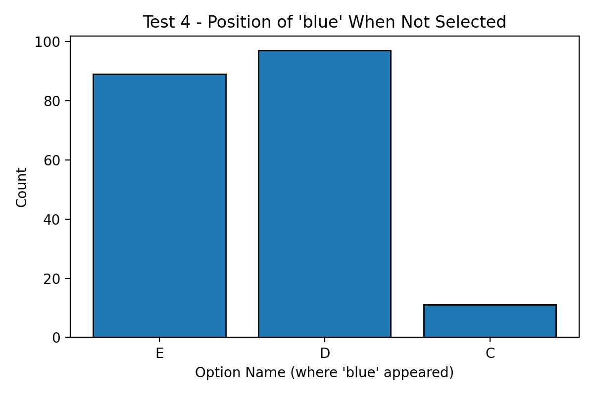

# Long answer

The experiment has this configuration:

```json
{
  "id": "d72ff8c1-d689-4d65-bd86-7ddb9c286e54",
  "name": "Test 4",
  "description": "Permute the options and run ten iterations for each one.",
  "iterations": 10,
  "strategy": "Permutations",
  "permutationDelayMs": 10000,
  "iterationDelayMs": 1000,
  "question": {
    "userMessage": "Which color does Sam like?",
    "systemMessage": "You are a helpful assistant."
  },
  "options": [
    { "name": "a", "value": "red" },
    { "name": "b", "value": "blue" },
    { "name": "c", "value": "green" },
    { "name": "d", "value": "yellow" },
    { "name": "e", "value": "other" }
  ]
}
```

I switched this up a lot of times.

My focus was:
1. the options, why not random strings or random meaningful latin text
2. the names of the subject, if any
3. the names of the options, what about 1,2,3,4,5
4. the system prompt

I'm sure there are other parameters to tweak, or values to try. Maybe you have objections at this point.
Please send them to me or contribute to the repo if you have the drive.

I have better things to do with my time. 🏞️

Following are the results of some of the more interesting tests I've run.

## random strings 1

Random strings instead of colors.

```json
{
  "id": "080afcb7-fc05-48aa-8f03-2ebc7b21c7e9",
  "name": "Test 2",
  "description": "Which random string does Sam like?",
  "iterations": 1,
  "iterationDelayMs": 0,
  "permutationDelayMs": 1000,
  "question": {
    "userMessage": "Which random string does Sam like?",
    "systemMessage": "You are a helpful assistant."
  },
  "strategy": "Permutations",
  "options": [
    { "name": "a", "value": "3wnjs5knvl" },
    { "name": "b", "value": "y05mniy4ce" },
    { "name": "c", "value": "57n9i4em54" },
    { "name": "d", "value": "yetq0ipy2k" },
    { "name": "e", "value": "other" }
  ]
}
```

This has a lower budget of one iteration per permutation. 
To be honest I worry about ChatGPT caching its responses,
and the planet. 🌎

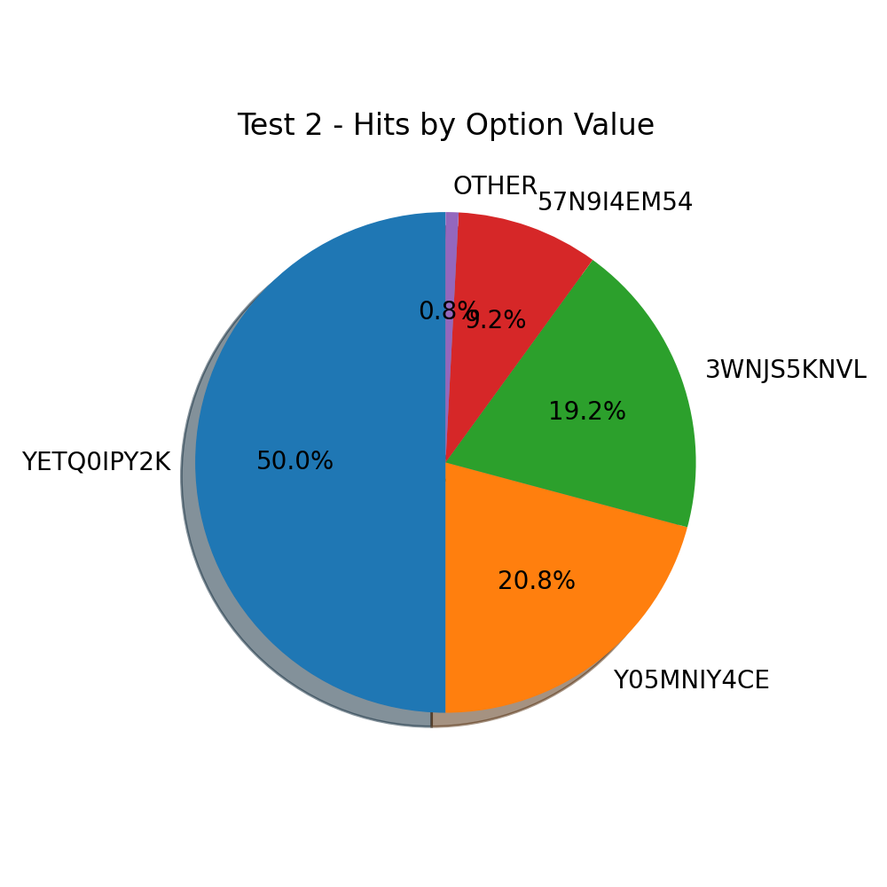

There's less bias towards a certain value. Although one random string got 50% of the hits it is not as strong as with `blue`.
The option `other` creeps in to the charts for the first time with almost 1%.

If we look at the option position bias,

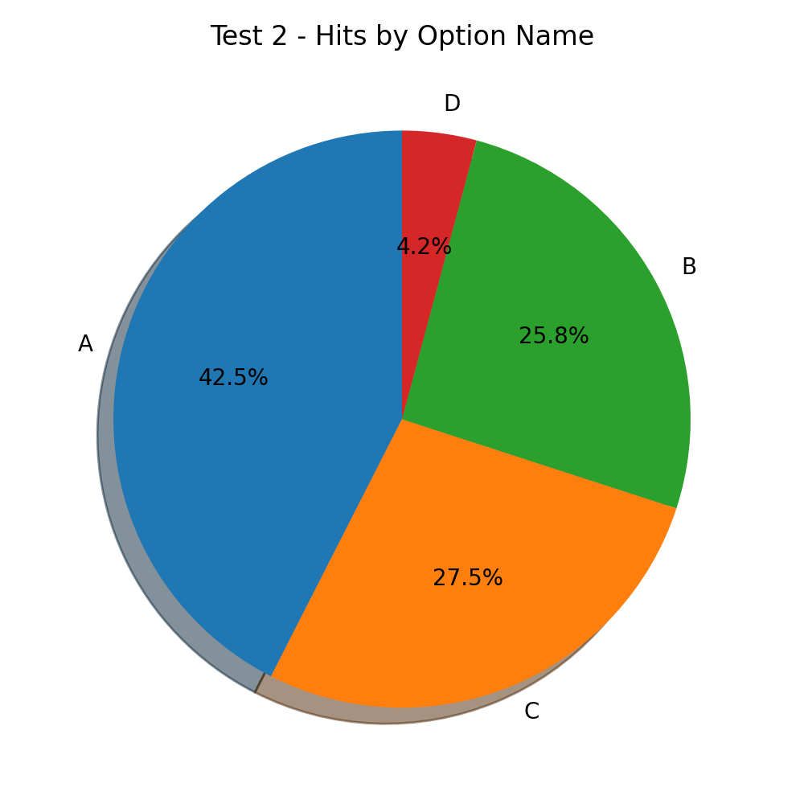

things are worrying.
`A` is still the leader with almost 40% of hits, `C` outclasses `B`, 
and this time we don't see E in the chart at all. zero, nada, jilts hits for E. 😟

## random strings 2

But what if I change the strategy?
Instead of permutations I just randomize the options each iteration.
I want to be honest here, I wanted to run a million iterations, but the planet. 🌎

The results flip the script here a little bit.

Say hello to "nice idea for a t-shirt" graphic.

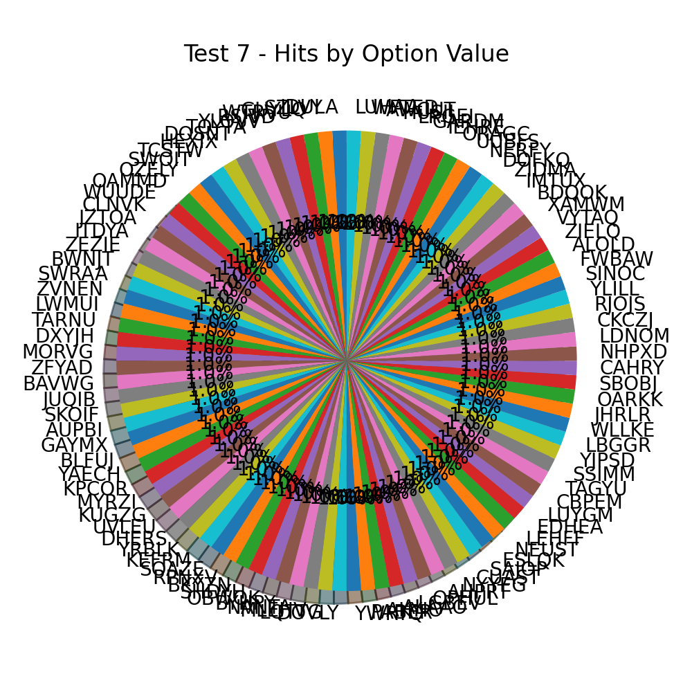

My **option bias theory** shakes a little bit:

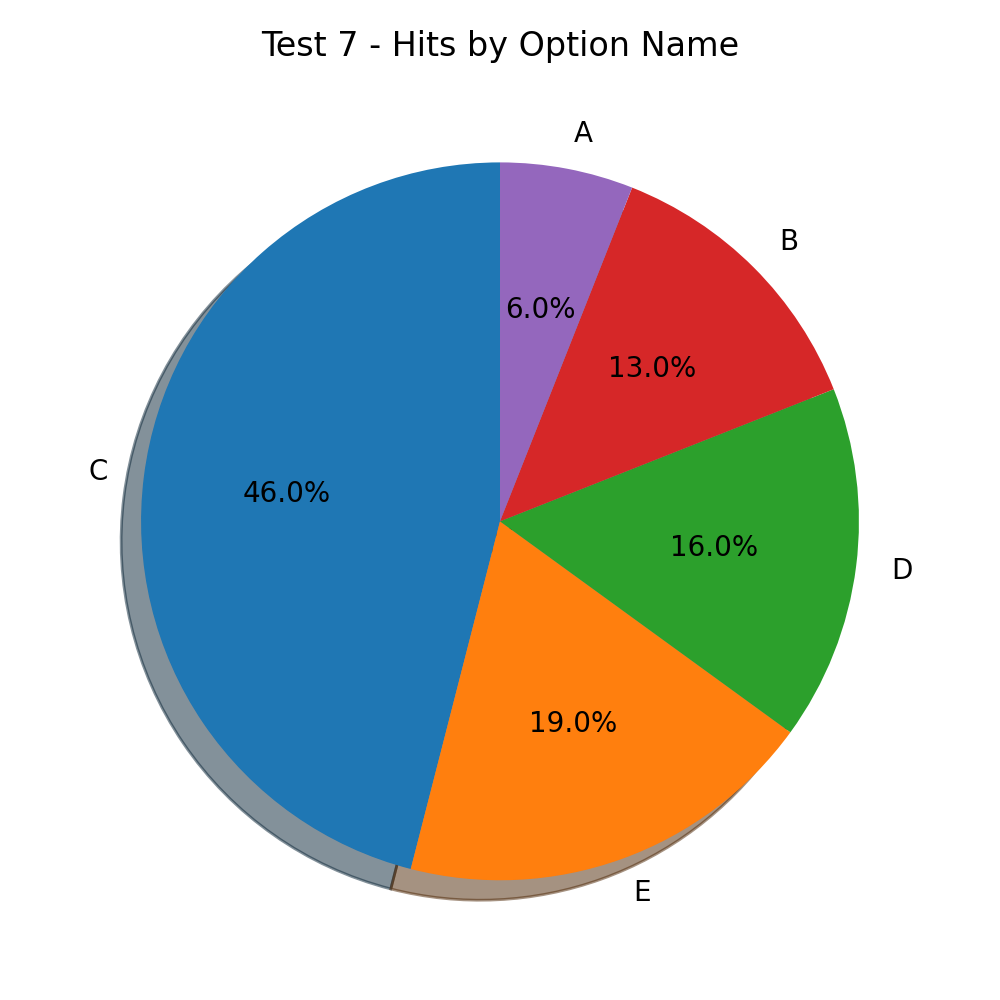

`C` is the new leader 🏆 with almost half of the hits. `A` comes last with 6%, while `B`, `D` and `E` take up the rest.

I questioned the previous model consistency, I checked whether there was so memory involved in my API code. 
I ran the what's your name test to be sure.
There isn't. ⚠️

At this point, I question the the consistency of the answers. What if it's not consistency but memory? I checked whether there was so memory involved in my API code. I ran the what’s your name test to be sure. There isn’t. ⚠️

Is it possible to draw a correlation between position C and the random string generation I’ve used below? It’s beyond the point of this experiment.

When we present the model with something it doesn’t understand, C is the favoured position.

This is the only conclusion I could draw so far. 

```java
String randomValue = random.ints(5, 'a', 'z' + 1).collect(StringBuilder::new, StringBuilder::appendCodePoint, StringBuilder::append).toString();
```

## different names

I tried different names, and no name at all. The result is the same.
A, B and C the preferred options and `Blue` the preferred color.

Names used:
- Sam
- Roger
- Julia
- James
- "Which color do you like?"

## 1, 2, 3, 4, 5

I've changed the name of the options to numerals.

I rewrote the system prompt to convince the model the selected option needs to be the numeral and not the color.

The results are interesting 🤔. There's less bias towards `blue`, but an exaggerated one to option `1`. 
With 61.7%, all the other options have less than half of the hits. `4` and `5` have together less than 10%.

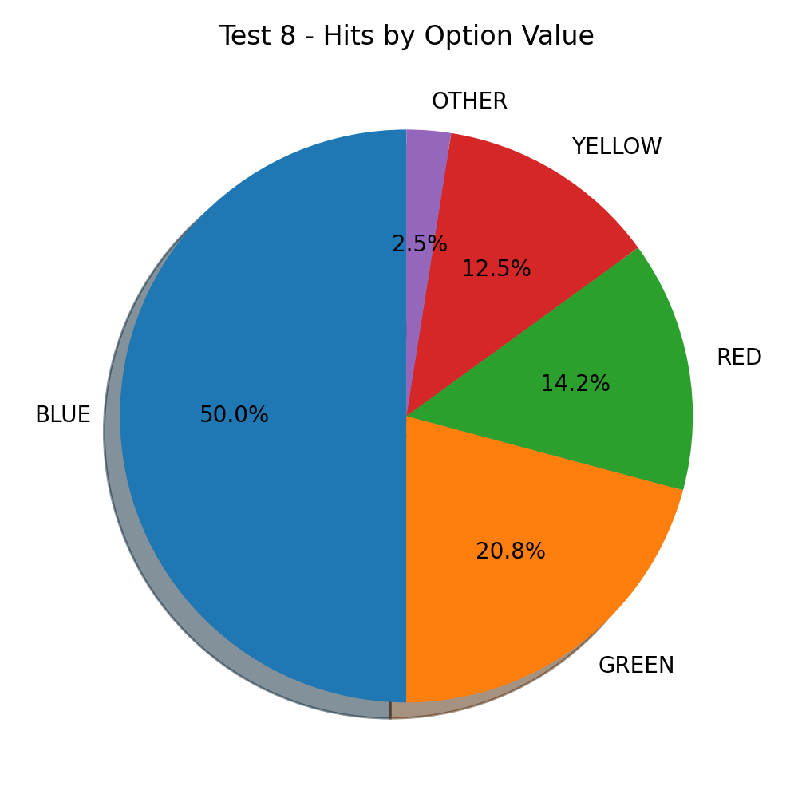

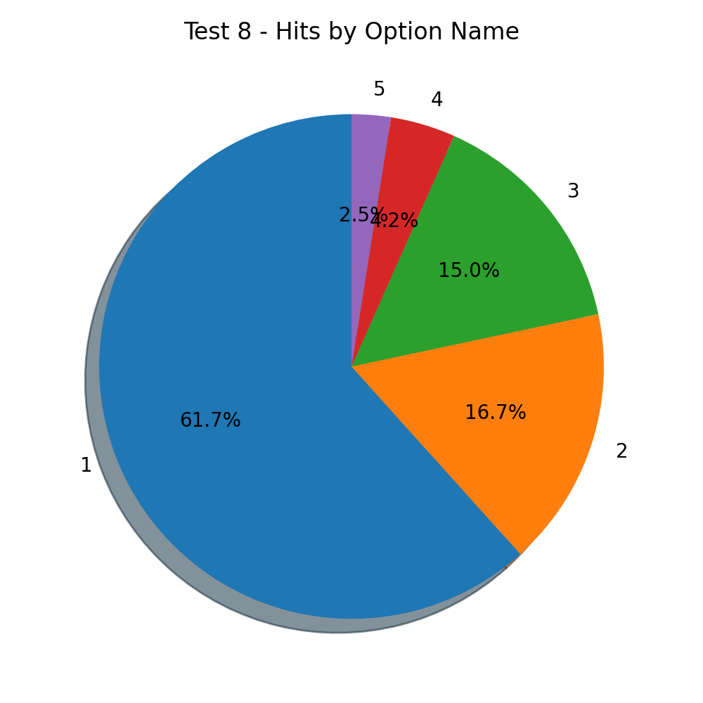

## the unknown option

From the first experiments, I've noticed that  `other` was never an option. But what does other mean in this context? It means a different color from the ones that are already present. Pink, purple, orange… Not popular choices. Maybe Pink.

Unknown means acknowledging you don’t know the answer. It could be any of the options.

I know from experience, large language models are confident beasts. They will tell a lie rather than say `I don't know`.

I want to see if changing `other` to `unknown` would have any impact.

And the result for this test is amazing:

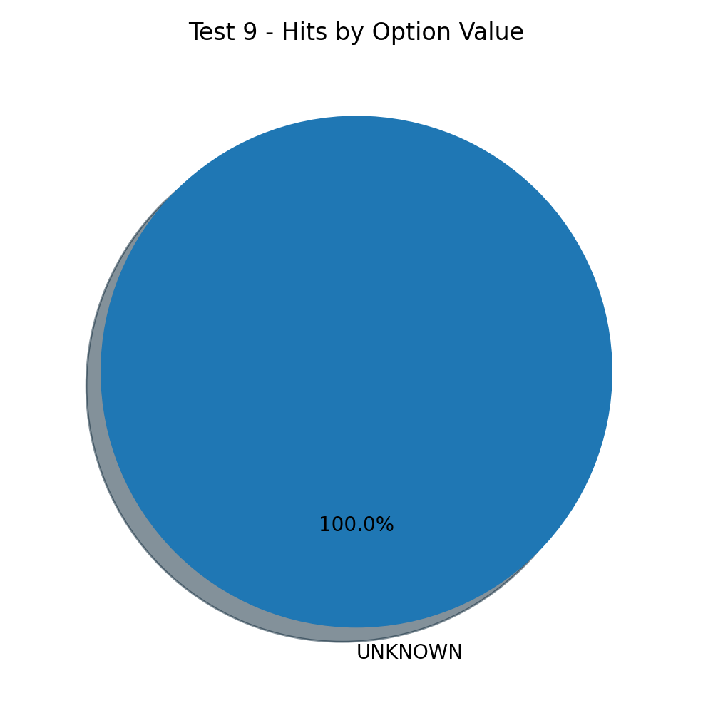

Absolute equality between all options. A wise response and a fair result.

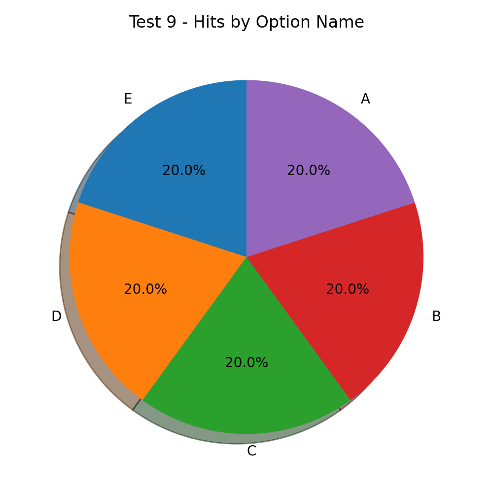

# Conclusion

There is a hiring process. At some phase of the process GPT is asked to choose between different candidates. You better start praying you’re not in position D or E. 🙏

You are adopting the MCP architecture. Does the choice of action to take depend on reasoning, bias or both? The structure of your prompts, tool descriptions and parameter order influence the outcome. How? All we have right now is a vibes approach and no standard based on facts. 

This deserves more attention. The bias is strong and persistent. It influences the outcome of any process that relies on a model’s choice.

Use literals instead of numerals if you're asking the model to choose between things for you.

The choice of words has a big impact as I’ve seen with `other` vs `unknown`.

Large language models are bias navigators. This is not the problem. The unthinkable biases, the ones that might exist at a lower level of abstraction than the domain. These are the ones that we can improve on understanding. 

Something you could mingle with to get better results.

# Further questions

This is not an all encompassing list, but here are some of mine essentials:

1. Does this reproduce `in your environment`?
2. How does this behave with other models?
3. Other languages?
4. How to extract more insights from the answers?
5. No names for options, just values?

# Code

Is yet to come.

java 21, spring-boot all the way. 
plots with python3.