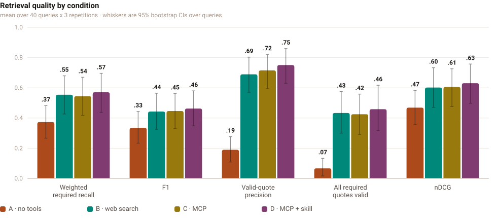
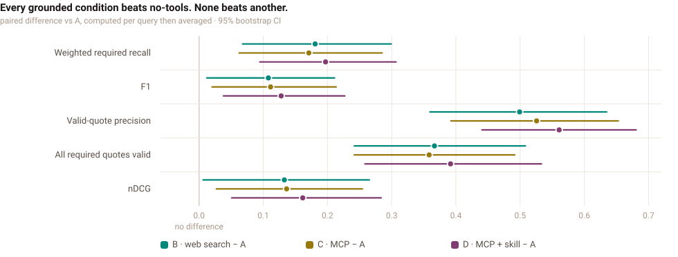
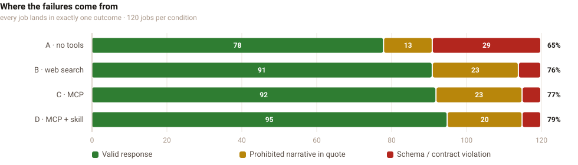
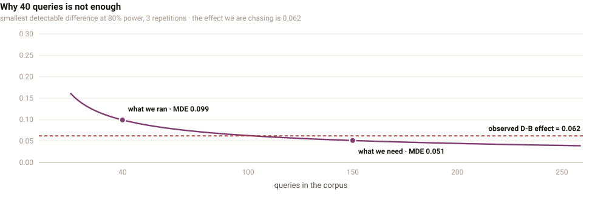
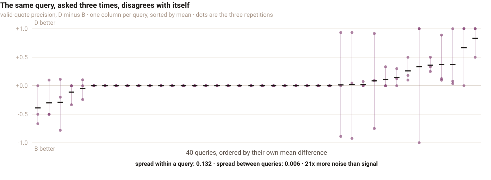
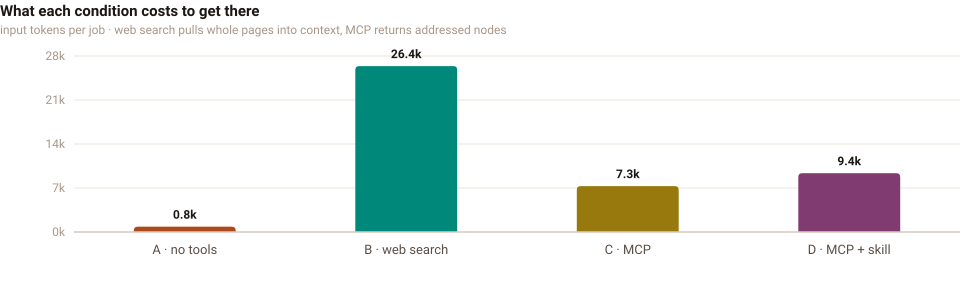

# The thing being tested

[aipolicies](https://aipolicies.eu/mcp) is an MCP server that serves the EU AI Act (2024/1689), GDPR (2016/679) and the Data Act (2023/2854) as addressable legal nodes. 

The idea is simple. A regulation is stored as a tree of individually addressable provisions — `gdpr-article-20`, `euaiact-annex-III` — so a model can ask for exactly one paragraph and get exactly that paragraph, with the EUR-Lex citation URL attached, instead of pulling a whole document into context and hunting through it. There are 12 tools in four groups:

- **Discovery** — `get_regulation_toc`, `list_regulation_nodes`, `list_dimensions`, `get_dimensions`, `list_regulation_documents`, `get_knowledge_base_report`
- **Search** — `search_regulations` (semantic), `search_regulations_text` (full-text), `search_by_dimension`
- **Retrieval** — `get_regulation_nodes`, `get_regulation_documents`
- **Feedback** — `report_error`

And there's also a [skill file](https://github.com/bitboyro/aipolicies.eu/blob/main/SKILL.md) — currently version one — that tells an agent which tool to reach for, how to chain them, and that every claim has to carry a citation. Tools alone work; the skill is what turns twelve endpoints into a workflow.

**What this benchmark measures is the retrieval surface** — the read tools a model uses to find text and fetch it: `search_regulations` and `search_regulations_text` to locate, `get_regulation_toc` and `list_regulation_nodes` to navigate, `get_regulation_nodes` and `get_regulation_documents` to fetch. Eleven read tools were exposed to the model in total. `report_error` was deliberately withheld: it's the one tool that writes, and 240 jobs pointed at the live knowledge base would have polluted it.

The pitch was the obvious one: a model grounded in a purpose-built legal corpus will cite the law better than a model left to its own memory, and better than one turned loose on web search.

The first half of that turned out to be true, and by a *lot*.

The second half I could not prove. So this post is about what happens when you build the instrument properly, point it at your own product, and don't like the reading. 😕

# The setup

40 legal-retrieval queries. Four conditions. Three repetitions each. **480 jobs**, one model, one day — **1 August 2026**.

| | condition | what it gets |
|---|---|---|
| **A** | no tools | model memory only |
| **B** | web search | the provider's hosted web search |
| **C** | aipolicies MCP | the MCP server, no instructions |
| **D** | MCP + retrieval skill | same server, plus a skill document telling it how to use the tools |

The queries span five categories — single-article lookups (10), cross-regulation scenarios (10), obligation inventories (8), edge cases (6) and questions practitioners actually asked (6) — across all three regulations.

## Why `gpt-5.6-luna`, and why the date matters

The model is `gpt-5.6-luna`. Three reasons, none of them glamorous:

**It had to make condition B strong, not a strawman.** The whole comparison collapses if the web-search baseline is bad. If I'd picked a model whose hosted search flailed, "my MCP server beats web search" would be a claim about the model, not about retrieval. Luna's hosted search is good — it hit `eur-lex.europa.eu` and nothing else, which is exactly what you'd want it to do.

**Money.** Same family as `gpt-5.6-terra`, roughly a third of the cost across 480 jobs. The reasoning behaviour, hosted MCP support and strict structured output are the same. Nano-class alternatives were rejected because they belong to older families whose support for those features is unconfirmed — and a model that can't hold the response schema would turn this into a benchmark of JSON compliance rather than retrieval.

**And here's the caveat.** `gpt-5.6-luna` is an undated alias. The provider publishes no pinned snapshot for it, so I cannot promise the model behind that string tomorrow is the model that ran on 1 August 2026. That's why the run window and the provider-reported model id on every one of the 480 responses are recorded as evidence. Models change under you. A benchmark that doesn't record *when* it ran is measuring something it can't name.

## What "the conditions differ in exactly one thing" actually means

This phrase does a lot of work, so here's the concrete version.

All four conditions send the **same model, the same sampling settings, the same system prompt, the same user prompt, the same response schema, and the same query text** — byte for byte. The request bodies are literally diffable.

The only permitted difference is the `tools` array:

- **A** — `tools: []`
- **B** — `tools: [web_search]`
- **C** — `tools: [aipolicies MCP server]`
- **D** — `tools: [aipolicies MCP server]`, plus one extra file appended to the prompt: the retrieval skill

Before the run starts, the runner builds all four request bodies for the same query and diffs them pairwise. If anything outside the tools array — or D's appended skill file — differs between them, it refuses to run. Not a warning. It stops.

That's the entire point of the check: it's very easy to accidentally give one condition a slightly better prompt and then report the difference as a finding about tools.

## What the model is asked to return

One thing: citations. No reasoning, no answers, no commentary. For each relevant provision, three fields — a canonical locator, a verbatim supporting quote, and where it came from.

```json
{
  "rank": 1,
  "locator": {
    "regulation": "EU_AI_ACT",
    "kind": "article",
    "article": "26",
    "paragraph": "6",
    "canonicalKey": "EU_AI_ACT:article:26(6)",
    "eurLexUrl": "https://eur-lex.europa.eu/eli/reg/2024/1689/art_26/oj/eng"
  },
  "supportingQuote": "Deployers of high-risk AI systems shall keep the logs …",
  "sourceType": "mcp",
  "mcpNodeId": "euaiact-article-26"
}
```

`sourceType` is one of `model-memory`, `web` or `mcp`. Hold onto that field — it comes back later.

## What the gold set looks like

Each query has a private gold record: the requirements a complete answer must satisfy, the locators that are acceptable for each, and a quote anchor verified as an exact substring of the official text. Four real examples, one per category:

**Single-article lookup** (`q001`) — *"Under the EU AI Act, when does an AI system that is itself a product, or is intended to be used as a safety component of a product, fall within the product-safety route to high-risk classification?"*
One requirement. Accepts `EU_AI_ACT:article:6(1)`, anchored on *"Irrespective of whether an AI system is placed on the market or put into service independently of the products referred to in points (a) and (b)…"*

**Edge case** (`q029`) — *"A university deploys an AI model specifically developed and put into service solely for scientific research and development. Does the EU AI Act apply merely because the model is operational?"*
One requirement: the sole-purpose research exclusion at `EU_AI_ACT:article:2(6)`. The trap is that the question sounds like it's about deployment; the answer is that the Act doesn't apply at all.

**Practitioner-sourced** (`q035`) — *"If someone open-sources a model, do they have to comply with the obligations for providers of general-purpose AI models?"*
One **required** requirement — the free-and-open-source exception at `EU_AI_ACT:article:53(2)` — plus two **optional** ones graded lower: `53(1)` for the baseline obligations the exception disapplies, and `55` for the systemic-risk obligations it *doesn't* reach. Getting the exception is passing. Knowing what it doesn't cover is the better answer.

**Cross-regulation** (`q011`) — an employer auto-rejecting the bottom 30% of job applicants with no human review, using data from applicants *and* from a recruitment agency.
Seven required requirements spanning both regulations: `EU_AI_ACT:annex:III(4(a))` and `article:6(2)` for high-risk classification, `26(2)` and `26(11)` for oversight and notification, `GDPR:article:13(1)+13(2)` for directly-collected data, `14(1)+14(2)` for agency-sourced data, and `22(1)` for the automated-decision restriction. Note requirements 5 and 6: each needs **two** locators together. Article 13(1) alone doesn't satisfy it.

Across all 40 queries that's 109 requirements, 109 acceptable-alternative sets and 114 quote anchors. Roughly eight separate legal judgments per query. Remember that number too.

# The pipeline

Before the claim about how it's scored, here's what actually runs:

1. **Plan** — 480 jobs (40 queries × 4 conditions × 3 repetitions) shuffled with a seeded Fisher–Yates, so conditions aren't clustered in time. The order is written to a file and hashed.
2. **Lock** — the manifest freezes model, prompts, schemas, tools, corpus, gold, pricing and retry policy. Hashes of every one, plus the runner's git commit and JAR hash, are recorded. Changing any of them means a new run ID, not an edit.
3. **Execute** — one job at a time, no concurrency. The exact request body, the raw response bytes, the tool trace, token usage and timing are all written to that job's directory. `result.json` is written last and is the only marker that a job finished.
4. **Classify** — each response gets exactly one outcome: valid, schema-invalid, contract-noncompliant, refused, truncated, or technically failed.
5. **Score** — locators are normalized, quotes are verified against the source snapshot, references are matched to gold requirements, metrics are computed.
6. **Adjudicate** — the handful of cases the scorer refuses to decide go to a human queue.
7. **Aggregate** — collapse the three repetitions per query, then average across queries, then bootstrap over queries for intervals.

## The part that matters: nothing here is judged by an LLM

There is **no LLM-as-judge anywhere in this pipeline.** Four things get decided in stages 4 and 5, and every one is a deterministic rule with a version number:

- **Contract compliance** — did the model return only citations, or did it smuggle in narrative, pack several provisions into one locator, or answer the legal question? A rule set, `prohibited-structure-v1`. (This is compliance with the *response contract*. Nothing in this benchmark judges whether anyone is compliant with the law — that would need a legal opinion, which is exactly the thing I refuse to let a model produce here.)
- **Locator matching** — does `GDPR:article:5(1)(c)` mean the same provision gold asked for? The canonical key is **re-derived** from the typed components and never trusted as a string. A key that disagrees with its own parts is a validation failure, not something to repair.
- **Quote verification** — is this quote present, byte for byte, in a **hashed snapshot of the original EUR-Lex publication text**, at the locator claimed? Either it is or it isn't. Fuzzy similarity can flag a case for review; it can never grant credit.
- **Scoring** — arithmetic over the above.

Captured evidence is immutable. Nothing is repaired, reprompted or re-rolled based on what a response contained.

## Where the human comes in — and what they're allowed to do

Stage 6, between quote verification and scoring, and only for one specific situation.

Sometimes the verifier finds a quote *in* the official text but can't determine **where** it lives — the string occurs in more than one provision, or it's a near-match that differs by a comma or a line break. Rather than guess, it refuses and queues the case.

The reviewer is shown the quote, its canonicalized form, and the candidate locations. They are **not** shown the condition, the model, the tool trace, or any preliminary score — those fields are stripped from the queue by contract. They can do exactly three things: accept one of the candidate locations, reject them all, or flag the source snapshot as defective.

Then the scorer runs its normal rule against whatever location was chosen. **A reviewer decides where a quote is. Never what it's worth.**

Until a case is decided, the score is reported both ways: once assuming every open case goes against the model, once assuming every one goes in its favour. That's how the uncertainty stays visible instead of quietly resolving itself.

That rule is the one I'm proudest of, and it's the one that made the results uncomfortable.



# Result 1: grounding wins, enormously

## What every metric on that chart means

Five bars per group, four conditions each. Here's what each one is actually counting.

| metric | question it answers | how it's computed |
|---|---|---|
| **Weighted required recall** | Of the provisions a complete answer needs, how many did it find? | matched required requirements ÷ all required requirements, weighted |
| **F1** | Balance of finding what's needed against not padding the list | harmonic mean of precision and recall |
| **Valid-quote precision** | Of the quotes it emitted, how many are really in the statute? | references whose quote is byte-exact at its stated locator ÷ all references returned |
| **All required quotes valid** | Did it get the *whole* answer right, with real text? | 1 if every required provision was found *and* every quote backing them is exact — otherwise 0 |
| **nDCG** | Did it put the most important provisions first? | standard ranking gain at k=10, using gold's 1–3 relevance grades |

Two more the chart doesn't show, because you asked the sensible question:

- **Precision** — of the references returned, the fraction that map to some gold requirement. A: 0.34 · B: 0.41 · C: 0.41 · D: 0.42.
- **Recall** — matched required requirements over all of them. A: 0.37 · B: 0.55 · C: 0.54 · D: 0.57. In this run it's numerically identical to weighted required recall, because every gold requirement happens to carry weight 1.0. The weighting machinery exists for corpora where some requirements matter more; here it changes nothing, and I'd rather say so than let a second bar imply a second finding.

**There's deliberately no "accuracy" number**, and it's worth saying why. Accuracy needs true negatives — the things correctly *not* selected. The model is picking from every provision of three regulations, so the true-negative count is enormous, arbitrary, and would push accuracy to ~0.99 for every condition regardless of quality. It's the wrong instrument for retrieval. Precision, recall and their combination are the right ones.

`allRequiredQuotesValidRate` is the harshest metric here and the most honest one. It's all-or-nothing per job: miss one required provision, or get one quote slightly wrong, and the job scores zero. It's the closest thing to "would a lawyer accept this answer as-is."

## The finding

Look at **valid-quote precision** — the fraction of emitted quotes that actually appear, verbatim, in the official text.

- **A (memory only): 0.19**
- B (web): 0.69 · C (MCP): 0.72 · D (MCP + skill): 0.75

An ungrounded model finds roughly the right *articles* — its recall is 0.37, not zero — and then **invents the wording**. It knows where to look and makes up what it saw.



## What "the interval is clear of zero" means

Every grounded condition beats A on every metric, and none of those gaps could plausibly be noise. Here's how that's established.

For each query, I take that query's mean score under condition B and subtract its mean under condition A. That's one paired difference. Forty queries gives forty differences. Then I resample those forty differences with replacement, ten thousand times, and each time take the mean. The middle 95% of those ten thousand means is the confidence interval.

If that whole interval sits above zero, then across ten thousand resamplings of my own data, B never once looked *worse* than A on average. That's what "clear of zero" means.

Five metrics × three grounded conditions = **fifteen contrasts. All fifteen are clear of zero.** The smallest of them — F1 for B over A — is +0.108 with an interval of [+0.011, +0.210]. The largest, valid-quote precision for D over A, is +0.561 with [+0.436, +0.677]. This is not a subtle effect.

If you take one thing from this post: **an LLM citing law from memory produces text that looks like statute and isn't.** Four in five of its quotes don't survive a byte comparison against EUR-Lex.

And the practical version of that: **use a tool.** Any tool. A purpose-built legal MCP server if you have one, plain web search if you don't — this benchmark cannot tell you which is better and says so below. But the gap between *grounded* and *ungrounded* is enormous, unambiguous, and reproduces on every single metric. Do not let a model cite law from memory. It will be confident, it will find the right article, and it will make up what the article says.

# Result 2: the model claims sources it never had

## First: what counts as a valid response

Every job lands in exactly one outcome. Three of them show up in the data:



**Valid response** (green) — parses as JSON, satisfies the response schema, is about the right query, and contains only citations. A: 78 · B: 91 · C: 92 · D: 95, out of 120 each.

**Contract violation** (amber) — a well-formed response where the model broke the citation-only rule. Across all 480 jobs this fires 105 times, and 104 of them are the *same* violation: **packing several provisions into one locator.** The model writes one reference whose quote spans Articles 16 through 20 and staples a single canonical key to it. The prompt forbids this explicitly ("Never combine provisions in one locator or string, such as `Articles 4 and 5` or `Articles 4-6`; emit separate reference objects") and it happens anyway, in every condition, most often at rank 1. This is a real failure mode for anyone building citation pipelines: models want to bundle.

**Schema violation** (red) — the payload didn't satisfy the contract. In B, C and D this is rare (6, 5, 5) and mostly mundane: a canonical key that disagrees with its own components, like declaring `EU_AI_ACT:article:6(1)(a)` while the parts derive `EU_AI_ACT:article:6(1)(1)(a)`.

In **condition A it's 29** — and 28 of those 29 are one specific thing.

## The specific thing

Condition A had **no tools at all**. No web, no MCP, nothing. `tools: []`.

In 28 of its 120 jobs, it emitted references declaring `sourceType: "web"` — **124 references in total**.

Here's the mechanism, precisely, because it matters. The response schema is shared across all four conditions, and it permits three values for `sourceType`: `model-memory`, `web`, `mcp`. So `"web"` is legal *as JSON*. What rejects it is the runner's condition check: condition A permits only `model-memory`, because condition A had no web access. That's why these land as invalid rather than being silently scored.

I want to be careful about how much I read into this. The model was told `web` was a legal value in the shared schema, and "hallucinated a field value" is a boring reading. But `model-memory` was equally legal, and it was *true*, and it never picked it. Whatever the mechanism, the output asserts a retrieval path that did not exist, and any downstream system trusting that field is being lied to.

## A good response and a bad one, side by side

Same query — `q002`, *"For at least how long must a deployer retain logs automatically generated by a high-risk AI system when those logs are under the deployer's control?"* Both responses get the article right. One of them is usable.

**Condition A, repetition 2** — locator `EU_AI_ACT:article:26(6)`, correct:

> "Deployers of high-risk AI systems shall keep the logs automatically generated by that high-risk AI system**,** to the extent such logs are under their control, for a period appropriate to the intended purpose of the high-risk AI system **and at least six months**, unless provided otherwise in applicable Union or national law."

**Condition C, repetition 1** — same locator:

> "Deployers of high-risk AI systems shall keep the logs automatically generated by that high-risk AI system to the extent such logs are under their control, for a period appropriate to the intended purpose of the high-risk AI system**, of at least six months**, unless provided otherwise in applicable Union or national law, in particular in Union law on the protection of personal data."

The second one is the statute. The first one has an extra comma and says *"and at least six months"* where the law says *"of at least six months"*.

Scored: condition A gets precision 1.0, recall 1.0, F1 1.0, nDCG 1.0 — **and valid-quote precision 0.0.** It found exactly the right provision and misquoted it. This is what the 0.19 aggregate is made of. Not wild fabrication — small, confident, plausible drift, of exactly the kind nobody proofreads.

That separation is deliberate. Merging locator credit and quote credit into one score would hide the single most important behaviour this experiment exists to observe: **a model that knows where to look but not what the text says.**

## And hosted web search can't be audited at all

Condition B made 334 web search calls. The runner captured, for every one of them:

- **zero** result payloads
- **zero** call arguments

The provider's hosted web search returns *that it searched*, not *what it found*. So for condition B I cannot verify, from the captured evidence, that any quote came from anything it retrieved. When it surfaced domains at all it was exclusively `eur-lex.europa.eu` — genuinely good, it wasn't grounding on blogs — but on 33 of 120 jobs it surfaced nothing.

Conditions C and D expose 441 and 326 tool-result payloads, plus arguments on all 493 and 356 calls. You can follow the chain.

I originally wrote this up as *"condition B searches, then cites from memory anyway."* That was wrong. The metric behind it — "quotes found in tool results" — reads zero for B because the tool results aren't in the trace to search. Absence of evidence. I caught it by going back to the raw traces before publishing.

The real finding is narrower and I think more interesting: **for a legal-citation workload, hosted web search is unauditable by construction.** Not wrong — unauditable. Different problem.

# Result 3: the thing I wanted to prove, I couldn't

Here is where my product loses.

D leads on all five metrics. It also loses on none. And every single B-vs-C-vs-D contrast has a confidence interval straddling zero. The largest gap — D over B on valid-quote precision, +0.062 — comes in at **[−0.003, +0.135]**.

So: is a purpose-built legal MCP server better than generic web search?

**I don't know, and 40 queries was never going to tell me.**

That sounds like a wasted month. It wasn't — I had to build the whole instrument to find that out, and finding it out is the useful part. (With a lot of help from Claude, who also had to be talked out of a few conclusions the data didn't support. 😄)



This chart is the honest centre of the whole post. With 40 queries and 3 repetitions, the smallest difference this design can reliably detect is about **0.099**. The difference I'm chasing is **0.062**. The instrument cannot see at the range where the answer lives.

That is *not* "MCP shows no advantage." It is "this experiment was not built to answer that question." Reporting an underpowered null as a negative result is one of the most common ways to be confidently wrong, and I'd be doing it to my own product.

To actually resolve it I need roughly **150 queries** — which is where the call to action at the end of this post comes from.

## A finding hiding in the variance

While computing that power curve I found something I didn't expect.

Take the D-minus-B difference on valid-quote precision, per query, for each of the three repetitions. Then ask where the variation lives.



Each column is one query, sorted by its own mean. The dots are the three repetitions; the black tick is the mean.

The flat band through the middle is the good news: 21 of the 40 queries land on exactly zero all three times, because both conditions handle them identically.

Now look at either end. Same question, same tools, same prompt, three tries — and the difference swings the full range, from −1.0 to +1.0. On one run condition D nails every quote and B misses entirely; on the next run of the *identical query* it flips completely. Those columns are a full-height line, not a point.

The variance of that difference **within** a query is **0.132**. The variance **between** queries — the part that reflects which legal question was actually asked — is **0.006**. That's a **21× ratio**, and it's the wrong way round from what you'd hope.

Two things to be careful about here. This is about the *contrast* between two conditions, not about raw scores — queries do differ from each other in difficulty, substantially. And it's specific to this metric and this pair. But for the quantity I was trying to measure, run-to-run instability dwarfs it. I don't think this gets reported often enough, and if you're evaluating anything with a handful of samples per condition, it should worry you.

# Result 4: cost



Web search drags **26.4k input tokens per job** into context. The MCP conditions pull 7.3k and 9.4k, because they fetch addressed nodes instead of whole pages. Roughly 3× the input volume for statistically indistinguishable quality — and because reasoning and output tokens are similar across conditions, that works out to about **2× the token cost per query**, before the hosted search tool's own per-call charge on top.

**I'm deliberately not putting dollar figures in this post.** The rate card frozen into the experiment was transcribed by hand from a pricing page with no snapshot captured, and it turned out to be wrong. The token counts are verified exact against all 480 raw responses; the prices I multiplied them by are not trustworthy. Since the error is a uniform scale factor, the ratio survives and the absolute numbers don't — so only the ratio is here.

# What the benchmark told me to fix

I built this to compare conditions. What it actually produced first was a list of defects in my own server, which is a fair trade.

**The search filter rejects legal citations.** 82 of the 467 search calls across conditions C and D — **18%** — failed on input validation. 64 of them returned `Query contains disallowed characters`, and **all 64 contained a parenthesis**. The model asked for *"GDPR Article 20(1) right to data portability"* and my server refused, because `(` isn't on the allowlist. Paragraph notation is the single most natural token in a legal query and I was rejecting it. Another 18 tripped a prompt-injection pattern filter on legitimate statutory language. Both are fixes, not redesigns, and both are next.

**The skill works, and version one is thin.** Condition D used **28% fewer tool calls** than C (356 vs 493), hit **42% fewer errors** (30 vs 52), and nudged every single metric up. It's the cheapest improvement available and it's a markdown file. Version two should explicitly address the multi-provision packing failure — 104 occurrences across all four conditions, models bundling `Articles 16-20` under one key — and push quoting toward `get_regulation_nodes` output rather than search snippets, which are truncated and drift.

**Six of the eleven tools were never called once.** Here is every MCP call the 240 grounded jobs made, by name:

| tool | C calls | D calls | total | jobs that used it (of 240) |
|---|---|---|---|---|
| `search_regulations_text` (full-text) | 267 | 156 | **423** | 211 |
| `get_regulation_nodes` | 171 | 151 | **322** | 240 |
| `get_regulation_toc` | 25 | 29 | **54** | 52 |
| `search_regulations` (semantic) | 24 | 20 | **44** | 40 |
| `list_regulation_nodes` | 6 | 0 | **6** | 1 |
| `search_by_dimension` | 0 | 0 | **0** | 0 |
| `get_regulation_documents` | 0 | 0 | **0** | 0 |
| `list_regulation_documents` | 0 | 0 | **0** | 0 |
| `get_dimensions` | 0 | 0 | **0** | 0 |
| `list_dimensions` | 0 | 0 | **0** | 0 |
| `get_knowledge_base_report` | 0 | 0 | **0** | 0 |

Three things fall out of that table.

`get_regulation_nodes` was called in **every single one of the 240 jobs**. Whatever route a model takes, it ends at "fetch me this exact provision." That tool is the product; the rest is navigation.

**Full-text search beat semantic search roughly 10 to 1** (423 calls against 44). Either the semantic tool is described badly in the schema, or full-text is genuinely the right default for citation work — where the model already knows the words it's hunting for — and semantic search should be repositioned rather than promoted.

**The entire dimensions feature went untouched.** `search_by_dimension`, `get_dimensions` and `list_dimensions` are three of the twelve tools and zero of the 849 calls. That's the finding I least wanted and most needed: a whole capability that no model reached for unprompted, in 240 attempts. Either the tool descriptions don't communicate what dimensions are good for, or this workload doesn't want them. The skill can test the first explanation cheaply.

None of these change the headline result. All of them came out of the traces for free.

# Everything wrong with this

In the interest of not doing to you what I nearly did to myself:

- **n=40 is underpowered for the tool comparison.** Stated above, restated here. Treat B-vs-C-vs-D as unresolved.
- **61 quotes are still waiting on a human**, and they're not spread evenly: 27 in A, 28 in B, 2 in C, 4 in D. The reason is mechanical. MCP-sourced quotes are copied from the same text the scorer checks against, so they either match exactly or they don't — no middle ground. Memory-written and web-rendered quotes drift by a comma or a line break, which lands them in the "close, but I won't guess" pile. If every open case were resolved in the model's favour, A gains +0.030 and B gains +0.031 on valid-quote precision; C and D gain +0.002 and +0.004. No conclusion flips — but the gap I couldn't measure gets *smaller*, not bigger.
- **Single annotator.** I wrote the gold myself. There is no inter-annotator agreement statistic, and there should be.
- **One model, one day.** `gpt-5.6-luna`, an undated alias, run on 1 August 2026.
- **These are preliminary results**, scored at `score-v1` with adjudication pending. They will move.
- I built one of the four conditions. Read accordingly — which is exactly why the scoring is deterministic and the adjudicator is blind.

# What do I actually need?

I have an instrument and not enough data. That's a solvable problem, but it's the wrong half for me to solve alone.

**The engineering is done.** Immutable evidence capture, deterministic scoring, versioned rule sets, blind adjudication, full provenance. It runs for a few dollars and a day of wall clock. I can add conditions — including other people's servers — and re-run everything on demand. **I intend to publish the instrument once it's good enough, and the dataset alongside it once it's meaningful.** Right now it's neither, and shipping it in this state would just be noise.

**What I don't have is legal expertise at scale.** Getting to 150 queries is not a coding problem. Each query takes about 8 separate legal judgments to annotate — which provisions a complete answer needs, which locators are acceptable, which exact words to anchor on. That's roughly **1,250 decisions** about what the right answer actually is.


EU legal retrieval benchmarks *do* exist. The closest is the [AI Act Evaluation Benchmark](https://arxiv.org/abs/2603.09435) — 339 scenarios with an article-retrieval task — and there's [MLEB](https://arxiv.org/abs/2510.19365) for legal embedding retrieval, plus EURLEX57K, EUR-Lex-Sum and the Chat-EUR-Lex work. This is not virgin territory.

What none of them combines is: **EU-specific, expert-annotated, tool-using rather than plain RAG, and verified verbatim against official text.** The AI Act benchmark generated its 339 scenarios with `gpt-oss-120b` and its authors explicitly write that validation with legal experts "is required." That validation is the thing I'm asking for, and it's the thing that would make this corpus distinct rather than redundant.

I'm looking for partners — **law faculties, tech-law and AI-governance centres, legal clinics, doctoral researchers, law students, practitioners** anywhere in Europe. 

If you're interested or know someone who might be, don't hesitate to contact me. 🎓


