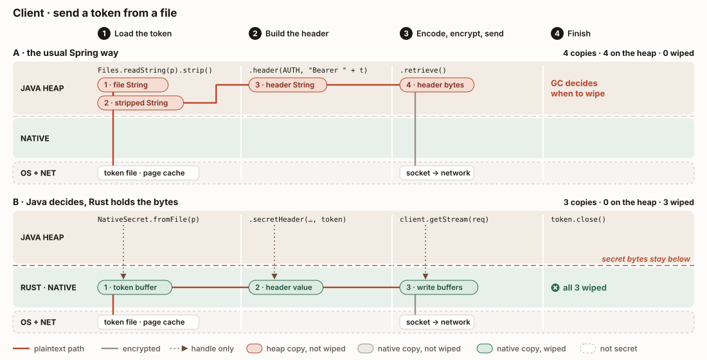
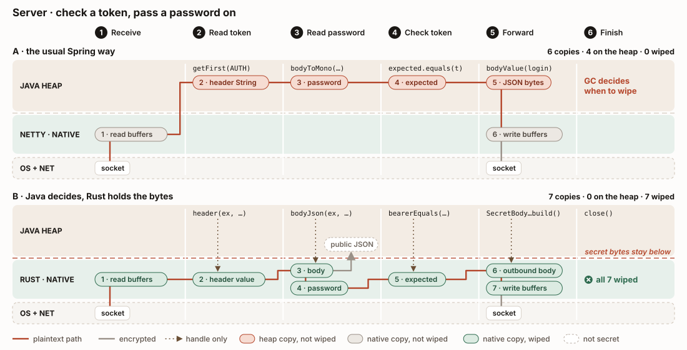

In Romanian, we have this word, *struțocămilă*. Take a *struț* (an ostrich)
and a *cămilă* (a camel), put them together, and there you have it. It's what
you call a combination that looks a little odd on paper.

For a while I'd wanted to build a *struțocămilă* of my own: one application,
part Java, part Rust. Java's syntax feels intuitive to me, and I like
thinking in objects. Rust gave me a way to get closer to the machine,
with more control over memory and performance. I wanted both in the
same application.

I just couldn't find a good reason to build it. I wanted something
practical, interesting enough to stick
with, and worth testing under real load. A demo where Java calls Rust to
add two numbers wasn't going to do it for me.

Then there was the business of making the two talk. I could call native
code from Java, but the interface never felt particularly inviting.
So the idea sat there for a while.

Until Panama.

Java's Foreign Function & Memory API made it much easier to call native
functions and work with native memory. It also gave me a new way to look
at a problem I'd run into on the Java side: I could decide when I was done
with a piece of sensitive data, but I had little control over what happened
to its bytes on the heap after that. Passwords and tokens were what I
cared about most, but the same problem applies to personal information,
confidential payloads, or any other sensitive data I'd rather not leave
lingering in memory.

Once a password or token becomes a `String`, I can't wipe it. I can drop my
reference to it, but I don't control when the garbage collector reclaims it
or when the bytes are overwritten. And that only accounts for my copy.
The libraries I pass it to may have made copies of their own.

So what if I kept those secrets off the Java heap in the first place?

# A secret has a lifetime. So does every copy.

The problem isn't new. In 2017, Pridgen, Garfinkel, and Wallach studied
persistent latent secrets in HotSpot in
[*Present but Unreachable*](https://www.cs.rice.edu/~dwallach/pub/persistent-but-reachable.pdf).
An object becoming unreachable and its old contents being overwritten are two
different events.

There are already useful tools for parts of this.
[DWP's secure-strings](https://github.com/dwp/secure-strings) stores a sealed
representation and provides methods to seal and reveal strings. That changes
how a secret is stored. Its example still accepts a Java string and returns
one when the value is revealed. The I/O path has more copies to think about.

On the Rust side,
[zeroize](https://docs.rs/zeroize/latest/zeroize/) and
[secrecy](https://docs.rs/secrecy/latest/secrecy/) already address clearing owned
memory and making exposure deliberate. Off-heap storage and explicit cleanup
are established techniques.

Java servers already use native libraries for TLS.
[Netty can use OpenSSL or BoringSSL](https://netty.io/wiki/forked-tomcat-native.html),
and [Tomcat can call OpenSSL through FFM](https://tomcat.apache.org/tomcat-11.0-doc/config/listeners.html).
But the question I was interested in starts one step later: once the bytes
are decrypted, can I use a token without turning it into a Java `String`?
And can I wipe the buffers I own when I'm done?

## Who is reading the memory?

None of this matters unless somebody reads the process memory:

- **A heap dump**, from `jmap` or `-XX:+HeapDumpOnOutOfMemoryError`. It holds
  Java objects only, so a secret that never became one isn't in the file.
- **Something reading the live process**: a debugger, a profiler agent, or
  `/proc/<pid>/mem`.
- **An over-read bug**, like Heartbleed, that sends out whatever sits next to
  a buffer.
- **Reused memory**: a freed block that wasn't cleared and turns up in the
  next allocation.

Fewer copies, held for less time, mean less for any of them to find. A
secret in use is still plaintext, and code inside the process or root can
read it then; that's out of scope. Swap and core dumps are in scope but not
handled yet, because the buffers aren't locked with `mlock` or marked
`MADV_DONTDUMP`.

## What I built

I picked two jobs an HTTP application does all the time.

1. **Client.** Load a token from a file and send it in an HTTPS
   `Authorization: Bearer` header.
2. **Server.** Receive an HTTPS request in a Spring handler, check its bearer
   token, and pass the password from its JSON body on to another service.

In both cases I wanted Java to decide what to do while the credential bytes
stayed off the Java heap.

Java and Rust run in the same process. The HTTP client uses reqwest and
rustls, and the server uses hyper and rustls. The native library exposes a C
ABI, and Java calls it through the Foreign Function & Memory API, finalized
in JDK 22.

### 1. Send a token from a file

Three classes do the work: `NativeSecret` holds the token, `NativePathRequest`
carries it as a header, and `NativePathHttpClient` sends it. Here are the
parts of each that matter.

#### NativeSecret: a native buffer with an owner

A `NativeSecret` is a small Java object around memory that Rust allocated. It
holds the native address, the length Java may read, and the capacity Rust
needs to free the allocation. Rust allocates the buffer, then gives up ownership so Java can hold it:

```rust
// np_secret_alloc
let (ptr, _len, cap) = SecretBuffer::new(vec![0u8; len]).into_raw_parts();
```

`into_raw_parts` calls `mem::forget`, so Rust doesn't free the buffer when
the function returns. From here on, Java decides when it goes away.

`fromFile` reads the file straight into that allocation. A file channel
writes into a `ByteBuffer` view of the native memory, so no Java array or
string is created on the way. Here's the read loop, with `ch` already open:

```java
long size = ch.size();
NativeSecret s = allocate(size, false);
java.nio.ByteBuffer buf = s.asMemorySegment().asByteBuffer();
while (buf.hasRemaining() && ch.read(buf) >= 0) { /* keep reading */ }
```

That `false` is `heapCopiesAllowed`. With it, `toByteArray()` and
`toUtf8String()` throw an `IllegalStateException` ("secret mode: copying this
value to the JVM heap is disabled; use asMemorySegment()") instead of copying
the value onto the heap. The default constructor and `allocate(length)` allow
those conversions. Code that borrows the segment can still read
and copy the bytes.

When the try-with-resources block ends, `close()` calls
`wipeAndFree(address, length, capacity)` once, which crosses into Rust. If
the code forgets to close it, a `Cleaner` does the same when the object is
collected. The core of `SecretBuffer::free_raw` takes the
buffer back, wipes it, and frees it:

```rust
let mut vec = Vec::from_raw_parts(ptr, len, cap);
wipe_vec(&mut vec);   // zeroes the whole capacity, not just the length
drop(vec);
```

Length and capacity are separate for a reason. Trimming a trailing newline
changes what Java sees, but the bytes beyond the new length still belong to
the buffer and get wiped too.

#### NativePathRequest: the header gets its own wiped copy

`secretHeader("Authorization", "Bearer ", token)` passes the prefix and the
token's native address to Rust. Rust copies both into a buffer of its own and
marks the header sensitive:

```rust
// np_request_header
let mut bytes = Vec::with_capacity(prefix_len + value_len);
bytes.extend_from_slice(prefix);   // "Bearer "
bytes.extend_from_slice(value);    // read from the NativeSecret's memory
r.headers.push(RequestHeader {
    name: name.to_string(),
    value: SecretBuffer::new(bytes),   // wiped when the request is dropped
    sensitive,
});
```

That copy is number 2 in the figure below. The token never passes through
Java on the way.

#### NativePathHttpClient: no idle connection, wipe on free

When a request carries a sensitive header or body, the client sends it on a
connection that isn't kept for reuse, and passes the sensitive flag on to
the HTTP library:

```rust
// send_stream
let isolated = sensitive_body || headers.iter().any(|h| h.sensitive);
let client = self.http_client(insecure, isolated)?;   // isolated: pool_max_idle_per_host(0)
...
let mut value = HeaderValue::from_bytes(h.value.as_slice())?;
value.set_sensitive(h.sensitive);
```

Once reqwest has the request, hyper and rustls make their own copies to build
and encrypt it: copy 3 in the figure. That code isn't mine, so I can't wipe
those buffers from it. Instead, the native library replaces Rust's global
allocator with one that wipes every block before it is freed:

```rust
#[global_allocator]
static GLOBAL: ZeroizingAllocator<System> = ZeroizingAllocator(System);

unsafe fn dealloc(&self, ptr: *mut u8, layout: Layout) {
    secure_wipe(ptr, layout.size());   // memset plus a compiler barrier
    self.0.dealloc(ptr, layout)
}
```

#### Using it: the client

The client needs a file path and a URL. The token goes straight from the file
into a native buffer, and the request takes that buffer as the header value.

```java
try (var token = NativeSecret.fromFile(tokenFile);
     var client = NativePathHttpClient.create();
     var request = NativePathRequest.get(url)
             .secretHeader("Authorization", "Bearer ", token);
     var response = client.getStream(request)) {
    // Read the response here.
}
```

Java supplies the header name and the `Bearer ` prefix as strings. The token
is passed separately as a `NativeSecret`. Closing it wipes and frees the
buffer loaded from the file. The copies made while building and sending the
request have lifetimes of their own.

<figure style="margin: 1.5rem 0;">
  <picture>
    <source media="(max-width: 640px)" srcset="/assets/images/nativepath/secret-copies-client-mobile.svg">
    
  </picture>
</figure>

A is the code most of us would write: `Files.readString`, a string
concatenation, `RestClient`. Every copy it makes lands on the Java heap, and
nothing ever overwrites them. When they go away is up to the garbage
collector, and even then the bytes stay until the memory is reused. B makes
about as many copies. The difference is where they live, and that each one
has an owner and a point where it gets wiped. Java only ever holds a handle.

### 2. Read a header and a JSON field in Spring

On the server the direction reverses. The Rust engine receives the request,
and Java picks the secrets out of it.

#### The engine: the request arrives in wiped buffers

hyper parses the request, and the engine collects the body into a single
buffer. When the request declares its length, that's a single allocation of
the right size:

```rust
let mut buf: Vec<u8> = Vec::with_capacity(declared.unwrap_or(0));
read_body(&mut body, &mut buf, &mut budget, max_body).await;   // on error: wipe_vec(&mut buf)
...
let request = ServerRequest {
    headers: SecretBuffer::new(packed),   // name\0value\0 pairs
    body: SecretBuffer::new(buf),
    ...
};
```

Both buffers are `SecretBuffer`s, so they're wiped when the request is
dropped. Java gets views of them, not copies.

#### ServerExchange: a secret header never becomes a String

Headers listed in `nativepath.http.server.secret-headers` are left out of
Spring's `HttpHeaders`. To read one, Java finds it in the packed native block
and copies the value into a new `NativeSecret`, from native memory to native
memory:

```java
// ServerExchange.headerSecret
NativeSecret s = NativeSecret.allocate(len, false);
MemorySegment.copy(headerBlock, valueStart, s.asMemorySegment(), 0, len);
return s;
```

#### SecretJson: split the body without parsing it into objects

`bodyJson` runs a small scanner over the JSON in native memory. It records
where each named secret field's value starts and ends, copies each value into
its own `NativeSecret`, and builds the rest of the document as an ordinary
`byte[]` with those values left out:

```java
// SecretJson.extract
for (Map.Entry<String, long[]> e : spans.entrySet()) {
    long len = e.getValue()[1] - e.getValue()[0];
    NativeSecret s = NativeSecret.allocate(len, body.heapCopiesAllowed());
    MemorySegment.copy(b, e.getValue()[0], s.asMemorySegment(), 0, len);
    secrets.put(e.getKey(), s);
}
```

The scanner handles top-level string fields. A secret value that contains a
JSON escape sequence is rejected rather than decoded on the heap.

#### Using it: the gateway

Picture a small gateway in front of a legacy account service.
A caller authenticates with a bearer token, and the request body carries a
user's password. The gateway checks the token, then forwards the password
to the account service, which verifies it. The gateway never needs to read
the password; it only passes it on.

```java
@Bean
RouterFunction<ServerResponse> verifyPassword(SecretSources secrets,
                                              NativePathHttpClient http) {
    return route(POST("/users/{id}/verify-password"), req -> {
        String userId = req.pathVariable("id");          // validated as [a-z0-9-]+
        try (NativeSecret auth = NativePathSecrets.header(req.exchange(), "authorization");
             NativeSecret expected = secrets.load("gateway-token");
             SecretJson.Extracted body = NativePathSecrets.bodyJson(
                     req.exchange(), Set.of("password"))) {

            if (!bearerEquals(auth, expected)) {
                return ServerResponse.status(UNAUTHORIZED).build();
            }
            NativeSecret password = body.secrets().get("password");
            try (NativeSecret upstreamBody = SecretBody.builder()
                         .text("{\"user\":\"" + userId + "\",\"password\":")
                         .jsonString(password)
                         .text("}")
                         .build();
                 var upstream = NativePathRequest.of("POST", accountServiceUrl)
                         .header("Content-Type", "application/json")
                         .secretBody(upstreamBody);
                 var response = http.getStream(upstream)) {
                return ServerResponse.status(response.statusCode()).build();
            }
        } catch (IOException e) {              // the token source could not be read
            return ServerResponse.status(SERVICE_UNAVAILABLE).build();
        }
    });
}
```

`authorization` is listed in `nativepath.http.server.secret-headers`, so the
engine keeps it out of Spring's `HttpHeaders` and the handler reads it as a
`NativeSecret`. `bodyJson` splits the body. The `password` field stays native,
and the rest becomes an ordinary `byte[]` for a JSON mapper. The expected
token comes from a `SecretSource` (a file, the macOS keychain, or Vault) and
loads straight into native memory.

`bearerEquals` is a few lines of application code that compares the two
native segments in constant time, the same idea as `MessageDigest.isEqual`.
Each try-with-resources scope closes its secrets: the incoming header, the
expected token, the extracted password, and the outbound body that embeds it.
At no point does Spring decode either credential into a string.

<figure style="margin: 1.5rem 0;">
  <picture>
    <source media="(max-width: 640px)" srcset="/assets/images/nativepath/secret-copies-server-mobile.svg">
    
  </picture>
</figure>

B makes *more* copies than A here, seven against six, because it splits the
body and loads the expected token on every request. So the count isn't what
changes. None of B's copies is on the Java heap, and every one is wiped. A's
Netty buffers are native too, but they go back to the pool unwiped, so being
native alone doesn't help. And A's counts are a floor: the scanner described
below found 44 copies of the token and 64 of the password in a server that
reads them the usual way.

# What the native approach costs

Keeping secrets in Rust-owned memory is the safer version of these two routes,
and it isn't free. None of the costs is a dead end, though:

| Cost | What helps |
|---|---|
| **More code.** Every secret is a resource with a scope, and Spring's data binding and Jackson can't touch those fields. | Most of it belongs in the library. Secret headers are already a config list, and `bodyJson` splits a body in one call. A Spring argument resolver could hand handlers their `NativeSecret` parameters. |
| **Protection ends at the first `String`.** A driver, SDK, logger, or validator that wants a `String` puts the secret back on the heap. | Native paths for the hops that matter, like the database engine at the end of this post. Keep secrets to as few hops as possible. |
| **Manual memory management.** A segment read after `close()` reads freed memory. | Tie each segment to an FFM arena, so closing it makes every view unusable. |
| **Native code in the process.** A bug in `unsafe` Rust or at the FFI boundary is a crash or a vulnerability, not an exception. | Keep `unsafe` at the boundary. Every entry point already catches Rust panics. Fuzz the boundary and audit dependencies with `cargo audit`. |
| **CPU and connections.** About twice Netty's server CPU per request, though level with Tomcat (measured below), and sensitive requests pay for a new TLS handshake. | Only requests that carry secrets skip the connection pool. The wipe is one bulk `memset`. |
| **Operations.** A native build per platform, and JVM tools don't see Rust's memory. | Releases already ship a library per platform. The zeroizing allocator sees every Rust allocation, so it can export native memory as a metric. |
| **What's still exposed.** Plaintext while in use, swap, and core dumps. | `mlock` and `MADV_DONTDUMP` on secret buffers, and no core dumps in production. Nothing fixes the first. |

One cost came from a finding rather than from the design. The zeroizing
allocator wipes every block when it is freed, but the scanner (described
below) found a token in a block that was never freed: the write buffer of a
kept-alive connection still held the last request's header after the request
had finished. That's why requests that carry a secret go out on a connection
that isn't kept for reuse, while everything else still uses the pool.

# How I measured it

Two Linux VMs with four cores and 8 GB each: one served, the other generated
the load. Everything ran in Docker on JDK 23. The short tests ran three
rounds of ten seconds each, and the long test ran for two hours. The
code, the harness, and the raw numbers are in the
[repository](https://github.com/bitboyro/nativepath).

# First, can the scanner see anything?

A scan that finds zero copies of a secret only means something if the same
scanner finds the copies when they are there. So the first job was to show
that it does.

The scanner lives in a small Spring WebFlux test server that runs on the
NativePath engine over HTTPS. It has three routes that receive a bearer token
and a JSON password, and one that searches for them:

- `/secure` reads both through NativePath, the same way as the gateway above,
  and answers `verified` when they match the planted values.
- `/error` reads them the same way, then throws, so the secrets are still in
  flight when the handler fails.
- `/control` reads them the way most Spring code does:
  `req.headers().firstHeader(...)` for the token and
  `req.bodyToMono(String.class)` for the body, so both become Java `String`s.
  It also keeps its last eight values in a list, the way an application that
  holds on to a value would. Without that, a busy server's garbage
  collections overwrite the copies before the scan reaches them, and a
  control that is only found sometimes proves nothing.
- `/__scan` counts how many times the token and the password appear in the
  server's own memory.

`/__scan` reads the server's own memory, every readable region listed in
`/proc/self/maps`, through `process_vm_readv`. That covers the Java heap,
Rust's heap, and the thread stacks. It never holds the value it looks for:
the planted token and password come from separate client processes, the
server only knows an XOR-masked version of each, and it unmasks one byte at a
time as it compares. Otherwise the search itself would plant a match.

In a standalone run, the control route left **44 copies of the token and 64
of the password** in memory. The protected route answered `verified`, so the
secrets really went through it, and the scan found **none**. Under load,
three cycles of all five request types gave the same picture: each control
left between 4 and 27 matches, and the protected, error, aborted-body, and
stalled-body requests left none.

A zero here means no exact copy of those bytes. Java stores an ASCII string
as one byte per character, which is why the control's `String`s match. A copy
stored as UTF-16, Base64, or in pieces would not. The load harness also
didn't check every response, so for the error, abort, and timeout cases I
know what was sent, not exactly how far the server got with it.

# The client wins on the direct path. Check what it handed you.

At sixteen threads, the direct client results look good:

| Body | JDK HttpClient | NativePath | Throughput change |
|---|---:|---:|---:|
| 256 B | 21,886 req/s | 28,756 req/s | +31% |
| 8 KB | 18,408 req/s | 25,342 req/s | +38% |
| 64 KB | 8,370 req/s | 9,613 req/s | +15% |
| 512 KB | 1,260 req/s | 1,295 req/s | +3% |

Now read the calls that produced them:

```java
// JDK path: materialize a Java byte array.
jdk.send(request, HttpResponse.BodyHandlers.ofByteArray()).body().length;

// NativePath path: receive a native body and inspect its size.
try (NativePathResponse response = np.get(url)) {
    return (int) response.bodyAsSecret().asMemorySegment().byteSize();
}
```

One gives Java a byte array; the other leaves the body native and checks its
size. That's a real advantage for an application that can keep the body
native, but it isn't the same work. Through Spring, where both sides have to
return a `byte[]`, the comparison is fair:

| Spring adapter, 512 KB / 16 threads | Throughput | Java allocation/request |
|---|---:|---:|
| JDK-backed | 1,276 req/s | 1,635,511 B |
| NativePath-backed | 1,240 req/s | 533,538 B |


The allocation advantage survives. The throughput win doesn't. The top row
of the chart is throughput, and the bottom row is Java allocation per request
on a logarithmic axis. Rust's own memory isn't in that counter.

# The server is slower than Netty and level with Tomcat

Three plain HTTP servers answered the same three routes, without TLS and
without Spring: `hello` returns five bytes, `payload` returns 64 KB, and
`json` echoes the body it receives. *NativePath + Java* is the Rust engine
accepting the connection and parsing HTTP, with a Java worker writing each
response. That's the setup the Spring integration builds on. Netty and
Tomcat were each started directly with their default settings.

Requests per second, and server CPU time per request:

| Route, connections | NativePath + Java | Netty | Tomcat |
|---|---:|---:|---:|
| hello, 16 | 31,997 · 32.7 µs | **38,019 · 18.2 µs** | 32,045 · 43.2 µs |
| hello, 64 | 69,187 · 25.3 µs | **84,167 · 12.4 µs** | 72,755 · 25.3 µs |
| payload 64 KB, 16 | 10,163 · 86.2 µs | 10,236 · 88.4 µs | 9,835 · 132.8 µs |
| json echo, 16 | 30,321 · 42.5 µs | **37,683 · 23.7 µs** | 32,197 · 44.0 µs |

Netty wins every small-response route and uses about half the CPU per
request. NativePath lands close to Tomcat on both counts. With 64 KB
responses, all three serve about the same number of requests.

Where does NativePath's CPU go? The Rust engine on its own, answering
`hello` without calling Java, used 21.3 µs per request at 64 connections. So
handing each request to a Java worker adds about 4 µs, and most of the gap
to Netty is in the engine itself. The run doesn't show how much of that is
the wiping.

# Two hours under load

The short tests measure speed. The long test asks whether it holds up: does
memory creep, do errors appear, do secrets stay out of memory over time?

The server was the Spring WebFlux test server from the scanner section, on
the NativePath engine over HTTPS. It took a steady **20,892 requests per
second**, 60% of the peak it reached in a short test, over 64 connections for
two hours. Every fifteen minutes it scanned itself: once after the control
route, and seven times after protected requests.


- **Requests:** 150 million, with no errors.
- **Memory:** the process grew from 501 MB to 660 MB in the first ten
  minutes, then barely moved. It ended at 664 MB.
- **Secrets:** the control scan found its markers. The seven protected scans
  found none.
- **Latency:**

| Latency | |
|---|---:|
| p50 | 0.8 ms |
| p99 | 5.9 ms |
| p99.9 | **1,618 ms** |

That p99.9 looks bad, and it most likely comes from the scanner rather than
the server. Each scan reads the whole 660 MB process and takes about three
seconds. It runs inside a request handler, so it holds a serving thread and
competes for CPU and memory bandwidth while it works. All 27 seconds with a
p99 above one second came within fifteen seconds of a scan. Away from the
scans, the worst second had a p99 of 74 ms.

I didn't run the same two hours without scanning, so that's a strong
association rather than proof. If you repeat this, scan from outside the
process, or run a second soak without the scanner to compare.

# What I would take from this

The *struțocămilă* works: Java decided, Rust held the bytes, and the
scanner found nothing left behind where plain Spring left dozens of copies.
The price is more CPU than Netty and more code to write, review, and run.

HTTP is also only one hop. To keep a secret off the heap from one end to the
other, every place it passes through needs a native path: the database
driver, the secret store, the message queue, anything that would otherwise
hand Java a `String`. The repository has a first step in that direction, an
early PostgreSQL engine in Rust with a JDBC adapter. It owns its protocol and
TLS buffers, and it reads and writes secret parameters and columns without
going through the heap. It is far from ready: in early tests it was about
three times slower than pgjdbc at reading rows, and about forty times slower
at batch inserts.

So for most applications, one language is still the better choice. A
two-language process is more to build, more to trust, and more to run, and
the heap problem doesn't go away until every hop is covered. Java itself
still can't promise that a secret on the heap is gone. You can zero a
`byte[]`, but the garbage collector may already have moved it and left the
old copy behind, and most libraries want a `String` anyway. Until that
changes, this is one way to shrink the problem, with clear costs, for
the few paths where it matters most.

# Reading list

- Pridgen, Garfinkel, Wallach,
  [*Present but Unreachable: Reducing Persistent Latent Secrets in HotSpot JVM*](https://aisel.aisnet.org/hicss-50/st/cybersecurity_and_sw_assurance/6/),
  HICSS 2017. Earlier work on the problem this experiment is investigating.
- [DWP secure-strings](https://github.com/dwp/secure-strings): encrypted stored
  representations and explicit reveal boundaries.
- [RustCrypto zeroize](https://docs.rs/zeroize/latest/zeroize/) and
  [secrecy](https://docs.rs/secrecy/latest/secrecy/): established secret-handling
  primitives and their documented limits. NativePath uses its own bulk wipe;
  these references aren't a transferred security audit.
- [Project Panama](https://openjdk.org/projects/panama), and
  [Oracle's account of FFM's introduction in JDK 22](https://inside.java/2024/09/17/jdk-23-available/).
- [Netty native TLS](https://netty.io/wiki/forked-tomcat-native.html) and
  [Tomcat's OpenSSL FFM integration](https://tomcat.apache.org/tomcat-11.0-doc/config/listeners.html):
  existing Java/native networking, and why *Java versus native* is the wrong
  baseline label.

This is a focused related-work list, not an exhaustive novelty search. No
hardware-enclave, universal-erasure, first-of-its-kind, or production-readiness
claim is made by these results.
